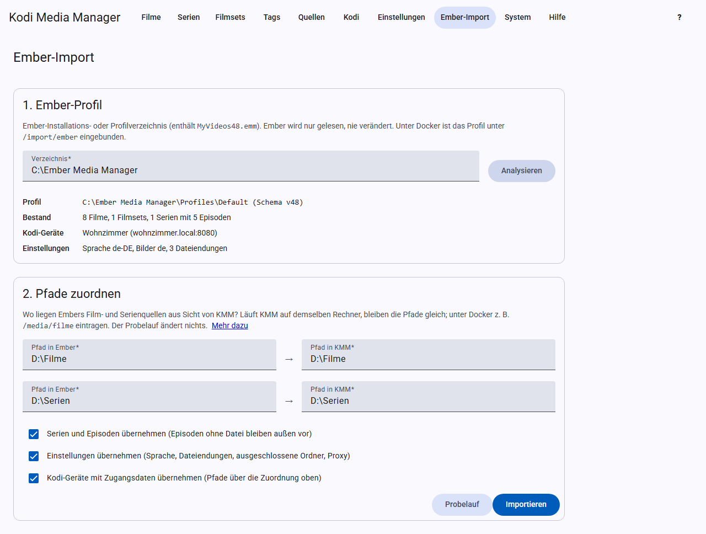

# Ember-Import

Der Assistent übernimmt deine Bibliothek aus Ember Media Manager. **Dein Ember-Profil wird nur gelesen**, NFOs und Bilder bleiben ebenfalls unverändert. Unterstützt wird die Datenbank-Version 48 (`MyVideos48.emm`). Ältere Profile öffnest du vorher einmal mit der neuesten Ember-Version, die aktualisiert sie selbst.

## 1. Profil hochladen

Klicke auf **Ember-Ordner wählen** und wähle den Ember-Installationsordner oder den Ordner `Profiles\Default` auf deinem Rechner. KMM muss dafür nicht auf demselben Rechner laufen wie Ember. Der Browser fragt womöglich, ob alle Dateien des Ordners hochgeladen werden sollen; hochgeladen werden aber nur die neueste Datenbank (`MyVideos48.emm`), `Settings.xml`, `AdvancedSettings.xml` und `Interface.Kodi.xml`.

KMM zeigt dir danach, was es gefunden hat: Filme, Filmsets, Serien, Episoden, Kodi-Geräte und Einstellungen.

**Zugangsdaten:** Diese Dateien enthalten die Zugangsdaten deiner Kodi-Geräte. Sie werden über dieselbe Verbindung wie die Oberfläche übertragen, ohne HTTPS also unverschlüsselt. Im Heimnetz ist das vertretbar, lade das Profil aber nicht ohne HTTPS über das Internet hoch. Mit **Hochgeladenes Profil verwerfen** löschst du die Dateien auf dem Server sofort; der Import und ein Neustart von KMM löschen sie ebenfalls.

## 2. Pfade zuordnen

Hier trägst du ein, wo Embers Quellen aus Sicht von KMM liegen. Läuft KMM auf demselben Rechner wie Ember, bleiben die Pfade gleich. Unter Docker wird zum Beispiel aus `D:\Filme` der Pfad `/media/filme`.

Darunter wählst du, was du übernehmen willst:

- **Serien und Episoden:** Episoden ohne Datei bleiben außen vor.
- **Einstellungen:** Sprache, Dateiendungen, ausgeschlossene Ordner und Proxy. Das Proxy-Passwort wird nicht übernommen.
- **Kodi-Geräte** mit Zugangsdaten. Ihre Pfade laufen über die Zuordnung oben.

## 3. Probelauf und Import

Klicke zuerst auf **Probelauf**. Er führt den Import vollständig aus und macht ihn dann rückgängig. Der Bericht zeigt also genau, was der Import ändern würde.

Passt alles, klicke auf **Importieren**. Nach dem Import löscht KMM das hochgeladene Profil, auch wenn der Import fehlschlägt oder du ihn abbrichst. Der Probelauf behält es für den Import danach.

## Der Bericht

Er zählt neue, aktualisierte und übersprungene Einträge und nennt

- die geänderten **Einstellungen**,
- **nicht übernommene Quellen**,
- **Hinweise**, zum Beispiel wenn ein Film in mehreren Sets war, denn Kodi kennt nur eins, übernommen wird das erste,
- **Filme ohne gefundene NFO**: Meist ist das Verzeichnis gerade nicht erreichbar oder die Zuordnung stimmt nicht. Die Angaben aus Ember sind trotzdem übernommen.

## Gut zu wissen

- **Ember gewinnt:** Metadaten kommen aus Embers Datenbank. Die NFO gilt danach als eingelesen, damit der nächste Scan die Ember-Daten nicht überschreibt.
- **Wiederholbar:** Ein erneuter Import aktualisiert, statt zu verdoppeln. Das gilt aber nur bei gleichen Pfaden. Änderst du die Zuordnung, entstehen die Einträge doppelt; leere dann vorher die Datenbank, siehe [Neu anfangen](fehlerbehebung.md#neu-anfangen).
- **Umrechnung:** Freigaben wie `Germany:16` werden zu `FSK 16`.
- **Eigene Filmlisten** aus Ember werden zu gespeicherten [Filtern](filter.md), soweit sie sich übersetzen lassen.
- **Umbenennungs-Muster** aus Ember werden in die neue Schreibweise übersetzt.

**Nicht übernommen werden:** API-Keys, Embers Bildpfade (KMM findet Bilder über die Kodi-Namen neben den Dateien), Sperren und Markierungen sowie Episoden ohne Datei. Die API-Keys trägst du danach unter [Einstellungen](einstellungen.md#api-keys) ein.
