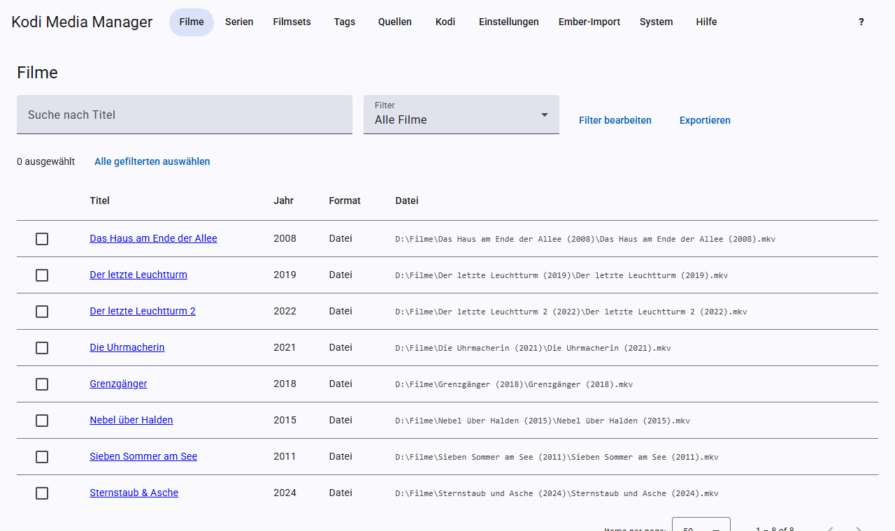
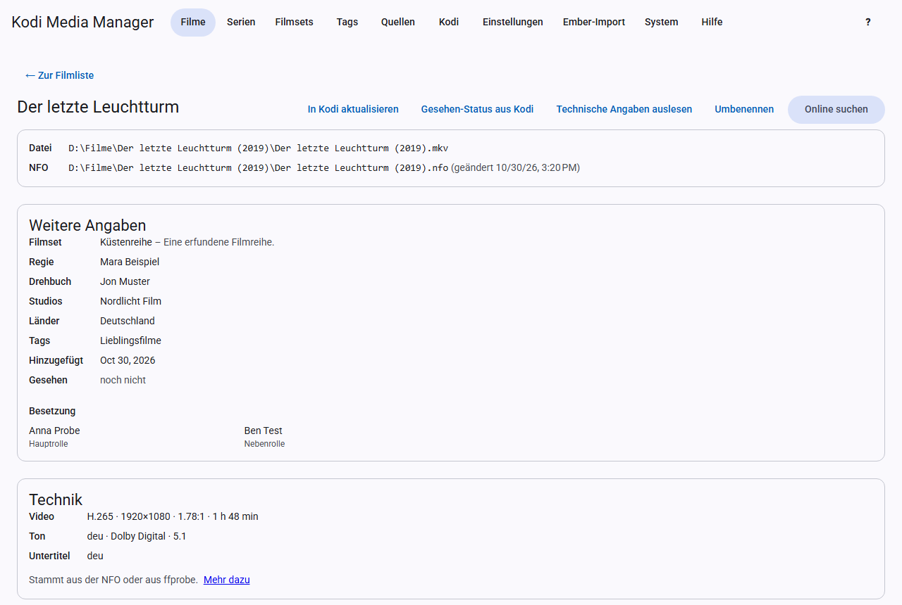

# Filme

## Die Filmliste

Die Seite **Filme** zeigt alle Filme mit Titel, Jahr, Format, Hinzugefügt und Datei. Ein Klick auf einen Spaltenkopf sortiert die Liste danach, ein zweiter dreht die Richtung um. So siehst du zum Beispiel mit **Hinzugefügt** die neuesten Filme zuerst. Die Seitenleiste steht über und unter der Liste. Oben kannst du nach dem Titel suchen und einen [Filter](filter.md) wählen. Über die Häkchen links wählst du Filme für [Stapel-Aktionen](filter.md#stapel-bearbeitung) aus, und über **Exportieren** lädst du die aktuelle Liste als [Export](export.md) herunter.

## Die Filmansicht

Ein Klick auf den Titel öffnet die Filmansicht. Sie zeigt von oben nach unten:

- **Datei und NFO:** wo der Film und seine NFO liegen. Gibt es noch keine NFO, legt KMM sie beim Speichern an.
- **Weitere Angaben:** Filmset, Bewertungen, Regie, Drehbuch, Studios, Länder, Tags, Gesehen-Status und Besetzung.
- **Technik:** Video, Ton und Untertitel.
- **Trailer**, **Titelmusik** und **Bilder**, siehe [Scrapen](scrapen.md).
- **Formular:** die Angaben, die du direkt bearbeiten kannst.

## Angaben bearbeiten

Ändere die Felder im Formular und klicke auf **Speichern**. KMM schreibt dann die NFO und aktualisiert Kodi, wenn der [Echtzeit-Sync](kodi.md#echtzeit-sync) eingeschaltet ist. **Verwerfen** stellt den gespeicherten Stand wieder her.

Einige Felder im Detail:

- **Sortiertitel:** bestimmt die Reihenfolge in Kodi, zum Beispiel „Pate, Der“ für „Der Pate“.
- **Fassung:** zum Beispiel „Director's Cut“. Lässt sich im Dateinamen verwenden und filtern.
- **Videoquelle:** zum Beispiel `bluray` oder `dvd`. Auch nutzbar im Dateinamen, Platzhalter `{source}`.
- **Altersfreigabe:** zum Beispiel „FSK 16“.
- **IMDb-ID:** `tt` und 7 bis 10 Ziffern. Mehrere Anbieter finden den Film darüber. Ohne sie gibt es keine Ergänzungen von Moviepilot, OFDb und OMDb.
- **TMDB-ID:** nur Ziffern.
- **Genres:** mehrere durch Komma trennen.

## Knöpfe der Filmansicht

| Knopf | Was passiert |
|---|---|
| **In Kodi aktualisieren** | Kodi liest diesen Film sofort neu ein. |
| **Gesehen-Status aus Kodi** | Holt Wiedergaben und eigene Bewertung aus Kodi. |
| **Technische Angaben auslesen** | Liest die Datei mit ffprobe aus. |
| **Umbenennen** | Benennt nur diesen Film nach den Mustern der Einstellungen um. |
| **Scrapen** | Ergänzt alles Fehlende nur für diesen Film, siehe [Scrapen](scrapen.md#automatisches-scrapen). |
| **Online suchen** | Sucht den Film bei einem Anbieter, siehe [Scrapen](scrapen.md#online-suche). |

## Technische Angaben

Die Karte **Technik** zeigt Codec, Auflösung, Seitenverhältnis, Laufzeit, HDR, Tonspuren und Untertitel. Die Angaben stammen aus der NFO oder aus ffprobe. Dafür muss FFmpeg installiert sein, siehe [Installation](installation.md#zusatzprogramme). Du kannst sie auslesen

- einzeln mit **Technische Angaben auslesen**,
- für eine ganze Quelle unter [Quellen](quellen.md),
- und automatisch nach dem Scrapen und nach dem Scan neuer Dateien, siehe [Einstellungen](einstellungen.md#technische-angaben).

Beim Schreiben ersetzt KMM in der NFO nur diesen technischen Teil, der Rest der Datei bleibt unverändert.

## Gesehen-Status

KMM holt den Status aus Kodi, nicht umgekehrt. Kodi ergänzt dabei nur mehr Wiedergaben, neuere Daten oder eine Bewertung und setzt nichts zurück.
