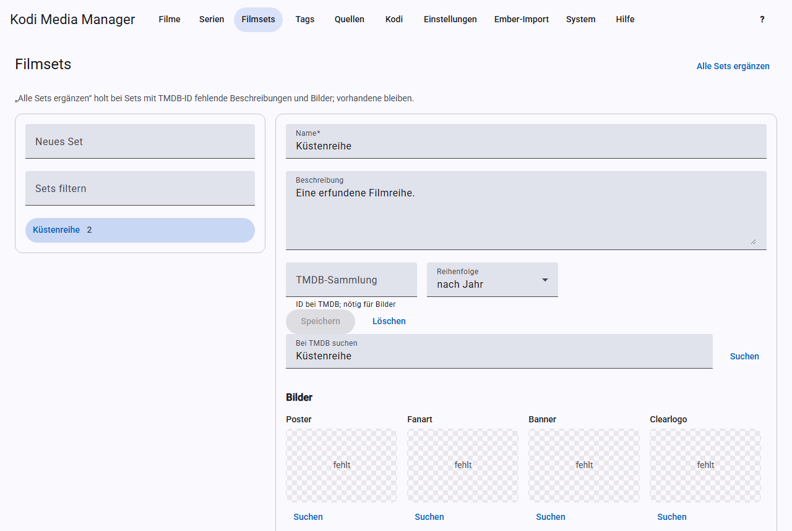

# Filmsets

Ein Filmset fasst zusammengehörige Filme zusammen, zum Beispiel alle Teile einer Reihe. Kodi zeigt sie dann gemeinsam an. **Ein Film kann nur in einem Set sein**, das gibt Kodi so vor.

## Set anlegen und bearbeiten

Trage links unter **Neues Set** einen Namen ein und drücke die Eingabetaste. Der Name muss eindeutig sein. Über **Sets filtern** findest du vorhandene Sets, und ein Klick öffnet die Details:

- **Name** und **Beschreibung**.
- **TMDB-Sammlung:** die ID der Sammlung bei TMDB. Sie wird für die Suche nach Bildern gebraucht.
- **Reihenfolge:** Sortierung der Filme im Set nach Jahr oder Titel.

Klicke auf **Speichern**. **Löschen** entfernt das Set, nicht die Filme.

## Sammlung bei TMDB suchen

Unter **Bei TMDB suchen** findest du die passende Sammlung. Ein Klick auf einen Treffer übernimmt Titel, Beschreibung und ID ins Formular. Speichere danach.

## Filme hinzufügen und entfernen

- **Hinzufügen:** Suche unter **Filme suchen**, setze die Häkchen und klicke auf **… hinzufügen**. Filme aus einem anderen Set wechseln dabei in dieses.
- **Entfernen:** Setze in der Filmliste des Sets die Häkchen und klicke auf **… entfernen**.

Die NFOs der betroffenen Filme werden im Hintergrund neu geschrieben. Mit [Echtzeit-Sync](kodi.md#echtzeit-sync) übernimmt Kodi Titel, Beschreibung und Bilder.

## Set-Bilder

Unter **Bilder** wählst du Poster, Fanart, Banner, Clearlogo, Clearart, Disc, Keyart und Landscape, wie bei [Filmen](scrapen.md#bilder). Die Suche braucht die TMDB-ID der Sammlung.

Wo die Bilder liegen, legst du unter [Einstellungen](einstellungen.md#filmsets) fest. Es gibt zwei Ablagen, die du einzeln einschaltest: Embers flaches Schema und Kodis Set-Ordner. Ist keine eingeschaltet, lässt KMM die Set-Bilder in Kodi unberührt.

## Alle Sets ergänzen

**Alle Sets ergänzen** holt für alle Sets mit TMDB-ID fehlende Beschreibungen und Bilder. Vorhandenes bleibt.

## Filme automatisch zuordnen

Mit der Einstellung „Filme beim Scrapen ihrem Filmset zuordnen“ kommt ein Film beim Scrapen in das Set seiner TMDB-Sammlung. KMM sucht das Set über die TMDB-ID, dann über den Namen, und legt es sonst neu an. **Ein anderes Set des Films wird dabei ersetzt.**
