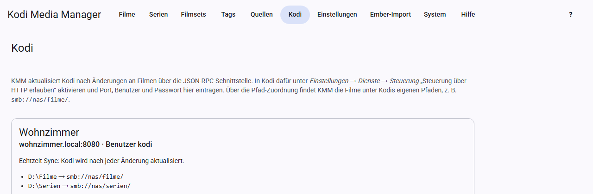

# Kodi

KMM hält deine Kodi-Geräte auf dem aktuellen Stand und holt den Gesehen-Status von ihnen.

## In Kodi vorbereiten

Öffne in Kodi *Einstellungen → Dienste → Steuerung* und aktiviere „Steuerung über HTTP erlauben“. Lege dort Port, Benutzer und Passwort fest.

## Gerät einrichten

Öffne **Kodi** und klicke auf **Kodi-Gerät hinzufügen**.

- **Name:** frei wählbar, zum Beispiel „Wohnzimmer“.
- **Adresse:** Rechnername oder IP-Adresse, ohne `http://`.
- **Port, Benutzer, Passwort:** wie in Kodi eingestellt. Beim Bearbeiten behält ein leeres Passwortfeld das gespeicherte Passwort.
- **Echtzeit-Sync:** siehe unten.

Prüfe die Einstellungen danach mit **Verbindung testen**. Das Ergebnis erscheint auf der Karte des Geräts. Kodi muss dafür laufen.

## Pfad-Zuordnung

KMM und Kodi sehen dieselben Dateien oft unter verschiedenen Pfaden. Die Zuordnung übersetzt zwischen beiden. **Ohne sie kann KMM keine Einträge in Kodi aktualisieren.**

| Pfad in KMM | Pfad in Kodi |
|---|---|
| `D:\Filme` | `smb://nas/filme/` |
| `/media/serien` | `nfs://nas/serien/` |

Lege für jede Quelle eine Zeile an. Den Pfad in Kodi siehst du dort unter *Videos → Dateien*.

## Echtzeit-Sync

Mit eingeschaltetem Echtzeit-Sync aktualisiert KMM Kodi nach jeder Änderung selbst:

- Geänderter Film, geänderte Serie oder Episode: Kodi liest den Eintrag neu ein. Eine geänderte Serie liest Kodi ohne ihre Episoden neu ein.
- Kennt Kodi den Eintrag noch nicht: Kodi durchsucht seinen Ordner.
- Neue Einträge nach einem Scan: Kodi durchsucht die Quelle.

Mehrere Änderungen kurz hintereinander lösen nur eine Aktualisierung aus, KMM wartet dafür einige Sekunden. Der letzte Abgleich steht auf der Karte des Geräts.

Aus KMM entfernte Filme bleiben in Kodi, bis dort die Bibliothek bereinigt wird.

## Von Hand aktualisieren

- **In Kodi aktualisieren** in Film-, Serien- und Episodenansicht wirkt auf alle Geräte.
- **In Kodi aktualisieren** in der Film- und Serienliste macht dasselbe für die Auswahl. Bei Serien liest Kodi nur die Serie neu ein, nicht ihre Episoden. Antwortet ein Gerät nicht, überspringt KMM es für den Rest des Laufs.
- **Kodi-Scan** bei einer [Quelle](quellen.md) lässt alle Geräte die Quelle durchsuchen.

Beides funktioniert auch ohne Echtzeit-Sync.

## Gesehen-Status holen

**Gesehen-Status** bei einer Quelle und **Gesehen-Status aus Kodi** in den Ansichten holen Wiedergaben, letzte Wiedergabe und eigene Bewertung. KMM schreibt sie in Datenbank und NFO, damit Kodi sie beim Neueinlesen nicht verliert.

Es werden nur mehr Wiedergaben, neuere Daten und Bewertungen ergänzt, nie etwas zurückgesetzt.

## Mehrere Geräte

Du kannst beliebig viele Geräte anlegen. Teilen sie sich dieselbe Kodi-Datenbank, genügt für den Gesehen-Status ein Gerät.

Kodi wird immer ohne den Proxy aus den Einstellungen angesprochen.
