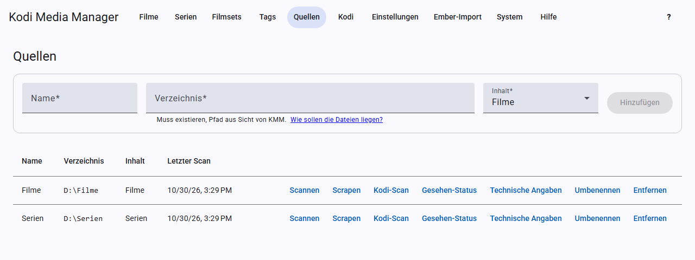

# Quellen und Scan

Eine Quelle ist ein Verzeichnis, in dem deine Filme oder Serien liegen. Du kannst beliebig viele anlegen.

## Quelle anlegen

Öffne **Quellen** und fülle die Felder oben aus:

- **Name:** frei wählbar, zum Beispiel „Filme“.
- **Verzeichnis:** der Pfad aus Sicht von KMM, zum Beispiel `D:\Filme`. Unter Docker ist es der Pfad im Container, zum Beispiel `/media/filme`. Das Verzeichnis muss existieren.
- **Inhalt:** Filme oder Serien.

Klicke dann auf **Hinzufügen**.

## Wie deine Dateien liegen sollten

**Filme** erkennt KMM als einzelne Videodatei, auch in einem eigenen Ordner, als mehrteiligen Film und als DVD- oder Blu-ray-Ordner. Die Bilder und NFOs liegen im Kodi-Schema daneben, zum Beispiel `Film-poster.jpg`, bei DVD und Blu-ray als `poster.jpg` im Filmordner.

**Serien:** Jeder Ordner direkt unter der Quelle ist eine Serie. Die Episoden dürfen beliebig tief darunter liegen. Staffel und Episode liest KMM aus dem Dateinamen, zum Beispiel `S01E05`. Eine Datei mit mehreren Episoden wie `S01E01E02` wird zu mehreren Episoden mit derselben Datei.

## Aktionen je Quelle

| Knopf | Was passiert |
|---|---|
| **Scannen** | Sucht neue und geänderte Dateien und liest NFOs ein. Bei neuen Dateien liest er auch die technischen Angaben aus, wenn das [eingeschaltet](einstellungen.md#technische-angaben) ist. |
| **Scrapen** | Ergänzt fehlende Metadaten und Bilder aller Einträge, siehe [Scrapen](scrapen.md). |
| **Kodi-Scan** | Lässt alle Kodi-Geräte diese Quelle durchsuchen, siehe [Kodi](kodi.md). |
| **Gesehen-Status** | Holt Wiedergaben und eigene Bewertungen aus Kodi. |
| **Technische Angaben** | Liest mit ffprobe die fehlenden oder alle Angaben neu aus. |
| **Umbenennen** | Öffnet die Vorschau zum [Umbenennen](umbenennen.md). |
| **Entfernen** | Entfernt die Quelle und alle ihre Einträge aus KMM, nach einer Rückfrage. Deine Dateien bleiben liegen. |

Während eine Aufgabe läuft, zeigt die Zeile den Fortschritt und einen Knopf **Abbrechen**.

## Der Bericht nach dem Scan

Das Ergebnis des letzten Scans steht in der Spalte **Letzter Scan**, auch wenn du die Seite zwischendurch verlassen hast. Hat der Scan etwas gefunden, öffnet sich unten ein Bericht, den du über **Details** jederzeit wieder aufrufst. Er nennt

- neue Filme, Serien und Episoden mit einem Link zum jeweiligen Eintrag,
- aktualisierte und entfernte Einträge,
- NFOs, die KMM nicht lesen konnte,
- bei Serien die **Dateien ohne erkennbare Episode**. KMM nimmt sie nicht auf, weil der Name keine Staffel und Episode wie `S01E05` enthält. Benenne sie um und scanne erneut.

Bei Serien zählen **neu**, **aktualisiert** und **entfernt** die Episoden. Lange Listen kürzt KMM nach 200 Einträgen. Ergebnis und Bericht gehen bei einem Neustart von KMM verloren, bis du wieder scannst.

## Der Bericht nach dem Scrapen

Bleibt beim Scrapen etwas offen, erscheint unten ein Bericht:

- **Ohne eindeutigen Treffer:** Diese Titel musst du einzeln suchen.
- **Fehler:** Etwas ging schief, zum Beispiel beim Schreiben einer Datei.
- **Hinweise:** Zum Beispiel ein nicht eingerichteter Anbieter.

## Dateiendungen und ausgeschlossene Ordner

Welche Dateien als Video gelten und welche Ordner der Scan überspringt, stellst du unter [Einstellungen](einstellungen.md#scan) ein.
