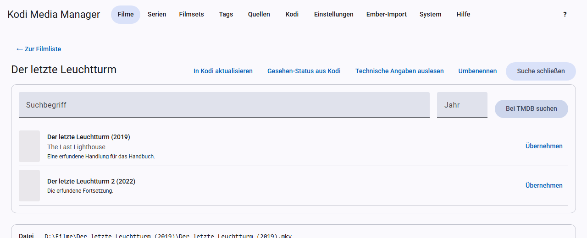
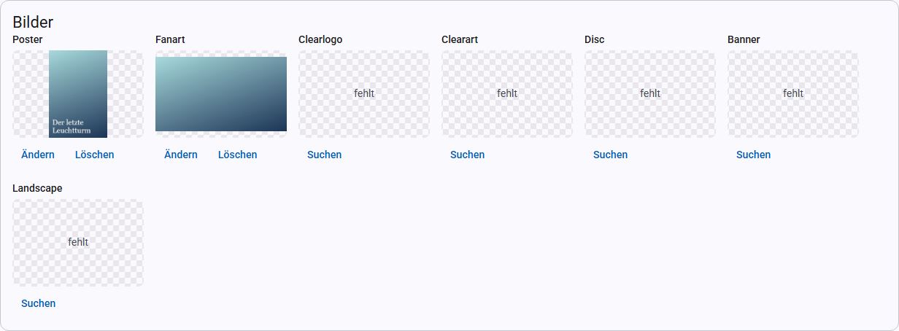

# Scrapen: Daten, Bilder, Trailer, Titelmusik

„Scrapen“ heißt, Angaben aus dem Internet zu holen. KMM kann das automatisch für einen einzelnen Eintrag, eine Auswahl oder eine ganze Quelle. Mit der Online-Suche ordnest du einen Eintrag selbst zu.

## Einen neuen Film scrapen

1. Lege die Datei in den Ordner der Quelle.
2. Klicke auf der Seite **Quellen** auf **Scannen**. Der Bericht nennt den neuen Film, mit einem Klick öffnest du ihn.
3. Klicke in der Filmansicht auf **Scrapen**. KMM holt Metadaten, Bilder, Trailer, Titelmusik und Bewertungen.
4. Steht der Film danach unter **Ohne eindeutigen Treffer**, ordne ihn über die [Online-Suche](scrapen.md#online-suche) zu und klicke danach noch einmal auf **Scrapen**.

Bei Serien gehst du genauso vor. Mehrere neue Einträge bearbeitest du am schnellsten in der Liste: Filter **Neu (letzte 30 Tage)** wählen, **Alle gefilterten auswählen**, **Scrapen**.

## Die Anbieter

| Anbieter | Liefert | Key nötig |
|---|---|---|
| TMDB | Filme, Serien, Bilder, Trailer, Filmsets | ja |
| TVDB | Serien, Bilder | ja |
| fanart.tv | Bilder | ja |
| OMDb | Bewertungen von IMDb, Rotten Tomatoes und Metacritic, englische Angaben für leere Felder | ja |
| Trakt | Community-Bewertung | ja (Client-ID) |
| Moviepilot | deutsche Angaben für leere Felder bei Filmen | nein |
| OFDb | deutsche Angaben für leere Felder bei Filmen | nein |
| TelevisionTunes | Titelmusik | nein |
| YouTube | Titelmusik, braucht yt-dlp | nein |

Keys trägst du unter [Einstellungen](einstellungen.md#api-keys) ein. Einen Anbieter ohne Key überspringt KMM.

## Online-Suche

Mit der Online-Suche ordnest du einen einzelnen Film oder eine Serie selbst zu. So gehst du vor:

1. Klicke in der Filmansicht auf **Online suchen**.
2. Wähle bei Bedarf die **Quelle** und ändere Suchbegriff und Jahr.
3. Klicke auf **Bei … suchen**. Findet sich nichts, versuche einen anderen Begriff oder lass das Jahr weg.
4. Klicke beim passenden Treffer auf **Übernehmen**. Die Angaben stehen jetzt im Formular, gespeichert ist noch nichts.
5. Prüfe das Formular und klicke auf **Speichern**.

Das speichert nur die Metadaten. Bilder, Trailer, Titelmusik und Bewertungen holt danach **Scrapen**.

Das ist auch der Weg für Titel, die beim automatischen Scrapen keinen eindeutigen Treffer hatten.

## Automatisches Scrapen

**Scrapen** gibt es an drei Stellen, die Wirkung ist überall dieselbe:

| Wo | Was bearbeitet wird |
|---|---|
| Film- oder Serienansicht | dieser Eintrag |
| Film- oder Serienliste, wenn du Einträge ausgewählt hast | die Auswahl |
| [Quelle](quellen.md) | alle Einträge der Quelle |

Das passiert dabei:

- Es füllt nur **fehlende** Metadaten und Bilder. Vorhandenes bleibt.
- Noch nicht zugeordnete Einträge übernimmt es nur bei einem **eindeutigen Treffer**. Die anderen nennt der Bericht.
- Bei Serien ergänzt es zusätzlich leere Episodenfelder, fehlende Bilder von Staffeln und Standbilder.
- Fehlende Trailer und sichere Treffer für die Titelmusik kommen ebenfalls dazu.
- Ergänzungs-Anbieter füllen leere Felder und holen fehlende Bewertungen. Deutsche Anbieter kommen dabei vor OMDb.
- Ist [Umbenennen nach dem Scrapen](einstellungen.md) eingeschaltet, benennt KMM die Einträge auch um.

Danach erscheint ein Bericht, in der Ansicht und in der Liste bleibt er stehen, bis du ihn schließt. Einträge ohne eindeutigen Treffer sind dort verlinkt. Endet das Scrapen einer Auswahl, während du auf einer anderen Seite bist, findest du den Bericht in der Liste unter **Ergebnis des letzten Scrapens**. KMM behält ihn, bis der Server neu startet oder er aus den letzten 50 Aufgaben herausfällt.

Ein laufendes Scrapen kannst du dort, wo du es gestartet hast, mit **Abbrechen** beenden. Während es in der Ansicht läuft, ist das Formular gesperrt, damit nichts überschrieben wird. Ungespeicherte Änderungen musst du vorher speichern.

Moviepilot und OFDb suchen nicht über den Titel allein: Eine Seite wird nur übernommen, wenn ihre IMDb-ID zum Film passt. Falsche Treffer sind damit ausgeschlossen, dafür findet nicht jeder Film einen Eintrag. Wegen einer Pause von einer Sekunde zwischen den Abrufen dauert das bei vielen Filmen länger. Der erste Abruf bei OFDb lädt außerdem das Verzeichnis der Seite und dauert entsprechend.

## Bewertungen

Das automatische Scrapen ergänzt nur fehlende Bewertungen. Um vorhandene zu aktualisieren, wähle die Einträge in der Liste aus und klicke auf **Bewertungen aktualisieren**. Der kostenlose OMDb-Key erlaubt 1.000 Abfragen am Tag, plane das bei großen Bibliotheken ein.

## Bilder

Die Karte **Bilder** zeigt jede Bildart mit dem aktuellen Bild oder dem Vermerk „fehlt“.

- **Suchen** oder **Ändern** zeigt die Vorschläge der Anbieter. Mit einem Klick auf einen Vorschlag übernimmst du ihn.
- **Löschen** entfernt das Bild.

Bilder deiner bevorzugten Sprache stehen weiter vorn, siehe [Einstellungen](einstellungen.md#sprache).

**Bildarten bei Filmen:** Poster, Fanart, Clearlogo, Clearart, Disc, Banner, Landscape. Die Dateien heißen wie von Kodi erwartet, zum Beispiel `Film-poster.jpg`.

## Trailer

KMM lädt keine Trailer herunter, sondern trägt einen Link in die NFO ein, den Kodi über das YouTube-Add-on abspielt.

- **Vorschläge suchen** zeigt Trailer von TMDB. Mit **Ansehen** prüfst du sie im Browser, mit **Übernehmen** trägst du sie ein.
- Unter **Eigener Link** trägst du einen Link von Hand ein, erlaubt sind `plugin://`, `http(s)://`, `smb://` und `nfs://`.
- **Entfernen** löscht den Eintrag wieder.

In der Liste holt **Fehlende Trailer holen** die Trailer für die Auswahl. Vorhandene Links bleiben.

## Titelmusik

Die Titelmusik liegt als `theme.mp3` im Film- bzw. Serienordner. **Kodi spielt sie nur mit einem Add-on wie TvTunes ab.**

- **Vorschläge suchen** zeigt Treffer von TelevisionTunes und YouTube. Du kannst sie anhören, ihre Seite öffnen und mit **Übernehmen** speichern.
- **Löschen** entfernt die Datei.

**Fehlende Titelmusik holen** in der Liste und das automatische Scrapen übernehmen nur sichere Treffer mit gleichem Titel beim Anbieter. YouTube-Videos gelten nie als sicher, die wählst du von Hand aus. Eine vorhandene `theme.mp3` bleibt in beiden Fällen unberührt.
