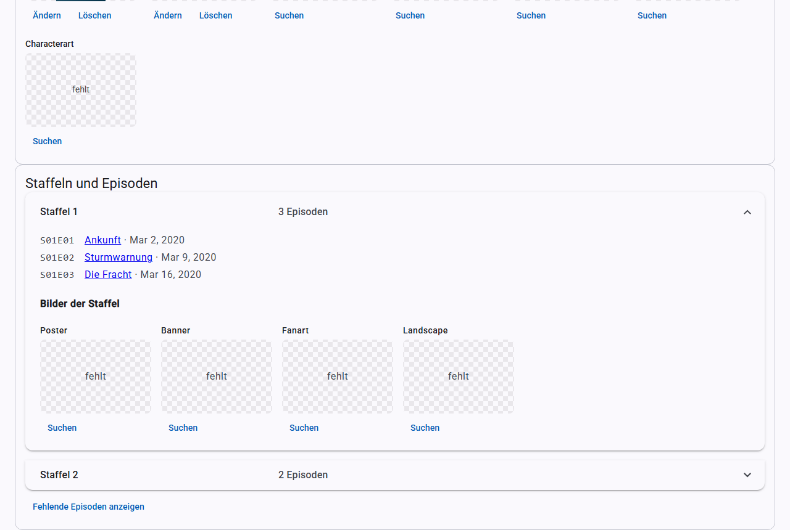

# Serien und Episoden

## Die Serienliste

Die Seite **Serien** funktioniert wie die [Filmliste](filme.md#die-filmliste), mit Suche, [Filtern](filter.md), Auswahl, [Export](export.md), Sortierung über die Spaltenköpfe und Seitenleiste über und unter der Liste.

## Die Serienansicht

Ein Klick auf den Titel öffnet die Serie:

- **Ordner und NFO:** wo die Serie und ihre `tvshow.nfo` liegen.
- **Trailer**, **Titelmusik** und **Bilder der Serie**, siehe [Scrapen](scrapen.md).
- **Staffeln und Episoden:** zum Aufklappen, mit den Bildern jeder Staffel.
- **Weitere Angaben:** Besetzung und Bewertungen.
- **Formular:** die Angaben der Serie.

Das Formular speicherst du wie bei Filmen mit **Speichern**. Zusätzlich gibt es **Status** (`Continuing` für laufend, `Ended` für beendet), **Sender/Studios** und **Tags**, jeweils durch Komma getrennt.

### Fehlende Episoden

**Fehlende Episoden anzeigen** fragt den Anbieter, welche Episoden es gibt, für die du keine Datei hast. Das ist nur eine Anzeige, KMM legt dafür nichts an.

## Eine Serie scrapen

**Scrapen** in der Serienansicht ergänzt alles Fehlende nur für diese Serie, auch leere Episodenfelder, siehe [Scrapen](scrapen.md#automatisches-scrapen).

## Eine Staffel scrapen

Klappst du unter **Staffeln und Episoden** eine Staffel auf, findest du zwei Knöpfe:

- **Staffel scrapen** arbeitet wie **Scrapen**, aber nur für diese Staffel. Es füllt leere Felder ihrer Episoden und holt fehlende Bilder der Staffel und Standbilder ihrer Episoden.
- **Staffel neu holen** ersetzt Titel und Inhaltsangaben der Episoden durch die des Anbieters, auch von Hand geänderte. Deshalb fragt KMM vorher nach. Was der Anbieter nicht hat, bleibt. Vorhandene Bilder ersetzt es nicht.

Beide Knöpfe ergänzen außerdem den Titel der Staffel, **Staffel neu holen** ersetzt ihn. Die übrigen Angaben der Serie bleiben unverändert. Trailer, Titelmusik und Bewertungen gehören zur ganzen Serie und kommen nur über **Scrapen**. Ist eine Serie noch nicht zugeordnet, übernimmt **Staffel scrapen** sie wie **Scrapen** nur bei eindeutigem Treffer. **Staffel neu holen** braucht eine zugeordnete Serie.

Ist das Auslesen technischer Angaben beim Scrapen eingeschaltet, liest KMM nach Änderungen die Episoden der Staffel aus, die noch keine technischen Angaben haben. Ist [Umbenennen nach dem Scrapen](einstellungen.md) eingeschaltet, benennt es Staffelordner und Episodendateien dieser Staffel um, der Serienordner bleibt.

Fortschritt und Bericht erscheinen oben in der Serienansicht. Solange eine Staffel oder die Serie gescrapt wird, sind alle Scrapen-Knöpfe der Serie gesperrt.

## Online-Suche für Serien

**Online suchen** arbeitet wie bei [Filmen](scrapen.md#online-suche). Die Vorgabe ist TVDB. Die übernommenen Angaben landen zuerst im Formular. Beim Speichern ergänzt KMM zusätzlich die Episoden, und zwar nur deren leere Felder. Ein Hinweis über den Knöpfen sagt dir vorher, wie viele Episoden betroffen sind.

Welche Reihenfolge der Episoden gilt (Ausstrahlung, DVD oder absolut), stellst du unter [Einstellungen](einstellungen.md#serien) ein. Das wirkt nur bei TVDB, TMDB kennt nur die Ausstrahlungsreihenfolge.

## Die Episodenansicht

Ein Klick auf eine Episode öffnet ihre Ansicht mit Datei, NFO, Standbild, technischen Angaben und einem Formular. Dort gibt es auch **In Kodi aktualisieren**, **Gesehen-Status aus Kodi** und **Technische Angaben auslesen**.

Teilen sich mehrere Episoden eine Datei, schreibt KMM die NFO für alle Episoden dieser Datei.

## Bilder bei Serien

| Wofür | Bildarten | Dateien |
|---|---|---|
| Serie | Poster, Fanart, Banner, Clearlogo, Clearart, Landscape, Characterart | `poster.jpg` usw. im Serienordner |
| Staffel | Poster, Banner, Fanart, Landscape | `season01-poster.jpg`, `season-specials-poster.jpg` im Serienordner |
| Episode | Standbild | `<episode>-thumb.jpg` neben der Episode |
