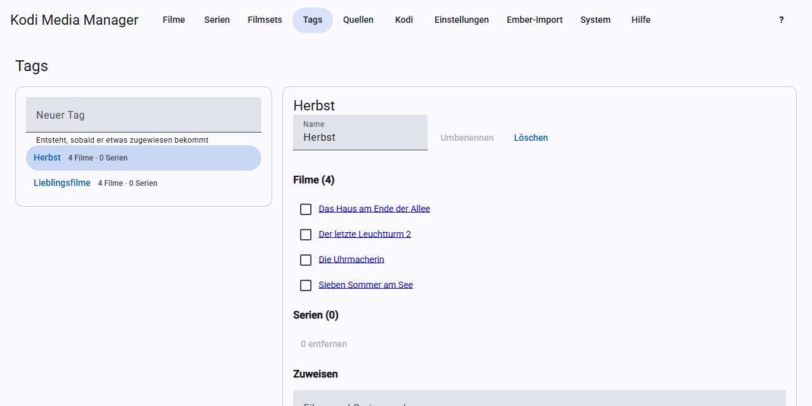

# Tags

Tags sind frei wählbare Stichwörter für Filme und Serien, zum Beispiel „Weihnachten“ oder „Kinder“. Kodi kann danach filtern.

Die Seite **Tags** zeigt links alle Tags mit der Anzahl der Filme und Serien. Ein Klick öffnet einen Tag.

## Neuer Tag

Trage unter **Neuer Tag** einen Namen ein und drücke die Eingabetaste. Der Tag entsteht erst richtig, sobald er etwas zugewiesen bekommt.

## Zuweisen

Suche unter **Filme und Serien suchen**, setze die Häkchen und klicke auf **… zuweisen**.

## Entfernen

Setze in der Liste des Tags die Häkchen und klicke auf **… entfernen**. Film oder Serie bleiben natürlich erhalten.

## Umbenennen und löschen

Ändere den **Namen** und klicke auf **Umbenennen**. Gibt es den neuen Namen schon, werden beide Tags zusammengeführt. **Löschen** entfernt den Tag von allen Einträgen.

## Was im Hintergrund passiert

Jede Änderung schreibt die NFOs der betroffenen Einträge als Hintergrund-Aufgabe. Mit [Echtzeit-Sync](kodi.md#echtzeit-sync) liest Kodi sie danach neu ein.

Tags für viele Einträge auf einmal setzt du am schnellsten über die [Stapel-Bearbeitung](filter.md#stapel-bearbeitung).
