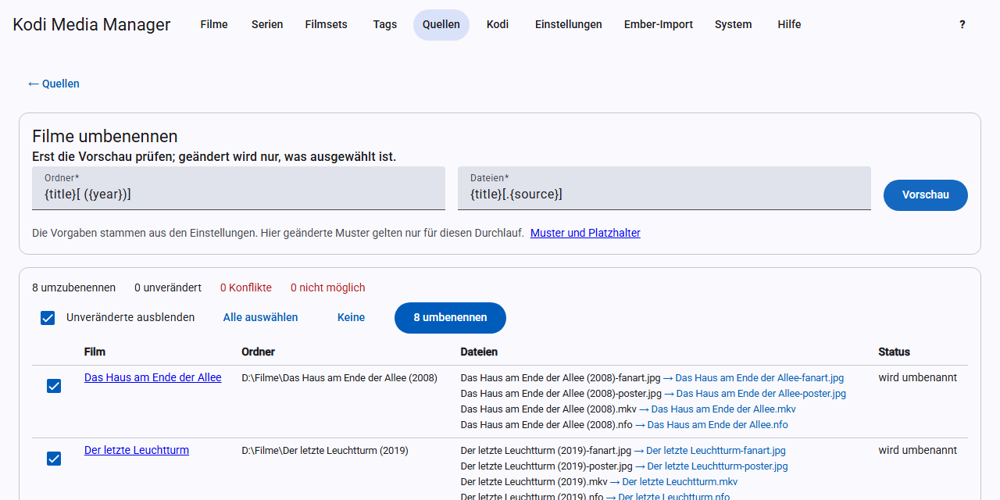

# Umbenennen

KMM benennt Ordner und Dateien nach Mustern um. **Das ändert deine Medienordner.** Prüfe beim ersten Mal die Vorschau genau und sichere vorher deine Daten.

## Muster festlegen

Die Muster stehen unter [Einstellungen → Umbenennen](einstellungen.md#umbenennen). Die Vorgaben sind:

| Was | Vorgabe | Ergebnis |
|---|---|---|
| Filmordner | `{title}[ ({year})]` | `Heat (1995)` |
| Filmdateien | `{title}[.{source}]` | `Heat.bluray.mkv` |
| Serienordner | `{show}` | `ALF` |
| Staffelordner | `Season {season:2}` | `Season 01` |
| Episodendateien | `{show} - S{season:2}E{episode:2}[ - {title}]` | `ALF - S01E05 - Der Besuch.mkv` |

## So sind Muster aufgebaut

- **Platzhalter** stehen in geschweiften Klammern: `{title}`.
- **Optionale Teile** stehen in eckigen Klammern: `[ ({year})]` entfällt samt Klammern, wenn das Jahr fehlt.
- **Unterordner** legst du mit `/` an, zum Beispiel `{title:first}/{title}`. Das geht nur beim Filmordner und gilt relativ zur Quelle.

### Formate

Ein Format steht hinter einem Doppelpunkt:

| Format | Wirkung | Beispiel |
|---|---|---|
| `:2` | mindestens zweistellig | `{season:2}` → `01` |
| `:first` | erster Buchstabe | `{title:first}` → `H` |
| `:sort` | Sortierform des Titels | `{title:sort}` |
| `:lower` | Kleinbuchstaben | `{title:lower}` → `heat` |
| `:upper` | Großbuchstaben | `{title:upper}` → `HEAT` |

### Platzhalter

**Filme:** `{title}`, `{originaltitle}`, `{sorttitle}`, `{year}`, `{edition}`, `{set}`, `{imdb}`, `{tmdb}`, `{genres}`, `{directors}`, `{countries}`, `{mpaa}`, `{rating}`, `{resolution}`, `{videocodec}`, `{audiocodec}`, `{channels}`, `{source}`, `{3d}`

**Serienordner:** `{show}`, `{originaltitle}`, `{sorttitle}`, `{year}`, `{imdb}`, `{tmdb}`, `{tvdb}`, `{genres}`, `{mpaa}`, `{rating}`

**Staffelordner:** wie Serienordner, dazu `{season}`

**Episodendateien:** wie Staffelordner, dazu `{episode}`, `{title}` (Titel der Episode), `{aired}`, `{resolution}`, `{videocodec}`, `{audiocodec}`, `{channels}`, `{source}`, `{3d}`

## Eine ganze Quelle umbenennen

1. Klicke bei der [Quelle](quellen.md) auf **Umbenennen**.
2. Ändere bei Bedarf die Muster. Änderungen hier gelten nur für diesen Durchlauf.
3. Klicke auf **Vorschau**. Noch passiert nichts.
4. Prüfe die Liste. Mit **Unveränderte ausblenden** siehst du nur, was sich ändert.
5. Wähle die Einträge aus, die umbenannt werden sollen, und klicke auf **… umbenennen**.

Die Vorschau zeigt vier Zustände:

- **Umzubenennen:** kann ausgewählt werden.
- **Unverändert:** heißt schon so.
- **Konflikt:** Das Ziel existiert schon. KMM überspringt den Eintrag.
- **Nicht möglich:** zum Beispiel, weil die Datei fehlt. Der Grund steht dabei.

## Einen einzelnen Eintrag umbenennen

In der Film- und der Serienansicht gibt es einen Knopf **Umbenennen**. Er nutzt die Muster aus den Einstellungen und zeigt vor dem Umbenennen eine Rückfrage. Ungespeicherte Änderungen musst du vorher speichern.

## Was genau umbenannt wird

**Filme:** der Ordner (nur wenn er allein diesem Film gehört), das Video, weitere Teile eines mehrteiligen Films und alle Begleitdateien mit dem Namen des Films, also NFO, Bilder und Untertitel. Bei DVD und Blu-ray nur der Ordner.

**Serien:** Episodendateien wandern mit NFO, Vorschaubild und Untertiteln in Staffelordner, danach wird der Serienordner umbenannt. Mehrfachepisoden heißen `S01E01E02` und tragen alle Titel. Staffelbilder bleiben nach Kodis Regel im Serienordner.

KMM zieht die Pfade in Datenbank und NFO nach. Geht etwas schief, nimmt es die Umbenennung des Eintrags zurück. Leere alte Ordner werden entfernt.

## Automatisch umbenennen

In den Einstellungen kannst du das automatische Umbenennen einschalten, anfangs ist es aus:

- Filme nach dem Speichern und nach dem Scrapen,
- Serien nach dem Speichern (Serie oder Episode) und nach dem Scrapen,
- neue Episoden beim Scan.

Dann gibt es **keine Vorschau**. Schalte es erst ein, wenn deine Muster bewährt sind.

## Was Kodi dazu macht

Mit [Echtzeit-Sync](kodi.md#echtzeit-sync) liest Kodi den neuen Ordner ein und bereinigt nur den alten. Gesehen-Status und Bewertung kommen aus der NFO zurück.
