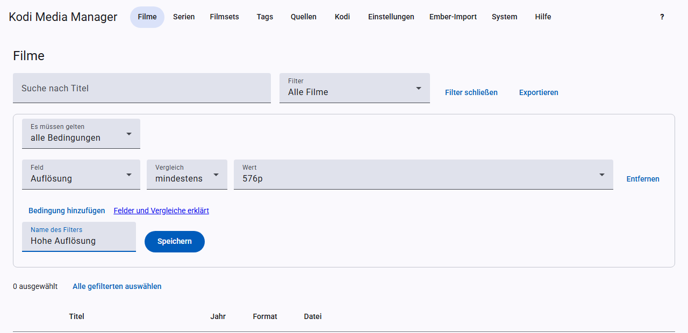

# Filter und Stapel-Bearbeitung

Film- und Serienliste lassen sich filtern, und alles, was du gefiltert hast, kannst du auf einmal bearbeiten.

## Filter wählen

Das Feld **Filter** bietet „Alle“, mitgelieferte und deine gespeicherten Filter.

**Mitgeliefert bei Filmen:** Ungesehen, Neu (letzte 30 Tage), Unter 720p, 4K, Ohne TMDB-ID, Ohne technische Angaben, Ohne NFO, Ohne Trailer.

**Mitgeliefert bei Serien:** Mit ungesehenen Episoden, Laufende Serien, Neu (letzte 30 Tage), Episoden unter 720p, Ohne TVDB-ID, Episoden ohne technische Angaben, Ohne NFO, Ohne Trailer.

## Eigenen Filter bauen

Klicke auf **Filter bearbeiten**. Ein Filter besteht aus Bedingungen, jeweils mit Feld, Vergleich und meist einem Wert. Bei **Es müssen gelten** wählst du, ob alle oder nur eine Bedingung zutreffen muss.

| Vergleich | Bedeutung |
|---|---|
| ist / ist nicht | genau dieser Wert |
| enthält | Text kommt vor, zum Beispiel im Titel |
| mindestens / höchstens | bei Zahlen |
| fehlt / vorhanden | Feld ist leer oder gefüllt |

Bei vielen Feldern wählst du den Wert aus einer Liste der Werte, die in deiner Bibliothek vorkommen.

**Felder bei Filmen:** Titel, Jahr, Genre, Tag, Land, Studio, Filmset, Gesehen, Eigene Bewertung, Altersfreigabe, Fassung, Videoquelle, Auflösung, Video-Codec, HDR, Audio-Codec, Audiosprache, Untertitelsprache, Technische Angaben, TMDB-ID, IMDb-ID, NFO, Trailer, Quelle, Hinzugefügt vor Tagen.

**Felder bei Serien:** Titel, Jahr, Genre, Tag, Studio/Sender, Status, Altersfreigabe, Eigene Bewertung, TVDB-ID, TMDB-ID, IMDb-ID, NFO, Trailer, Quelle, Hinzugefügt vor Tagen, Anzahl Episoden, Ungesehene Episoden und mehrere Felder „Episode: …“ für Auflösung, Codecs, Sprachen, Videoquelle und technische Angaben.

Bei „Episode: …“ genügt es, wenn mindestens eine Episode passt. Bei „ist nicht“ darf keine Episode passen.

**Speichern:** Trage unten einen Namen ein und klicke auf **Speichern**. Der Filter steht dann in der Auswahl. Ist ein gespeicherter Filter gewählt, kannst du ihn auch löschen.

Die Suche nach dem Titel gilt zusätzlich zum Filter.

## Auswählen

- Einzeln mit dem Häkchen links in der Liste.
- **Alle gefilterten auswählen** nimmt alle Treffer des aktuellen Filters, auch auf den weiteren Seiten.
- **Auswahl aufheben** leert die Auswahl.

## Stapel-Bearbeitung

Mit **Auswahl bearbeiten** änderst du alle gewählten Einträge auf einmal:

- **Genres und Tags** hinzufügen oder entfernen, mehrere durch Komma getrennt.
- **Filme:** Altersfreigabe, Fassung und Videoquelle setzen oder leeren.
- **Serien:** Altersfreigabe und Status setzen oder leeren.

Die NFOs werden geschrieben, und Kodi liest die Einträge neu ein. Umbenannt wird dabei nichts, auch wenn du das automatische Umbenennen eingeschaltet hast.

## Weitere Aktionen für die Auswahl

- **Fehlende Trailer holen**
- **Fehlende Titelmusik holen**
- **Bewertungen aktualisieren**
- **In Kodi aktualisieren**, siehe [Kodi](kodi.md#von-hand-aktualisieren)
- **Sprache ändern**, siehe [Sprache je Eintrag](scraping.md#sprache-je-quelle-und-eintrag)

Mehr dazu unter [Scrapen](scraping.md).
