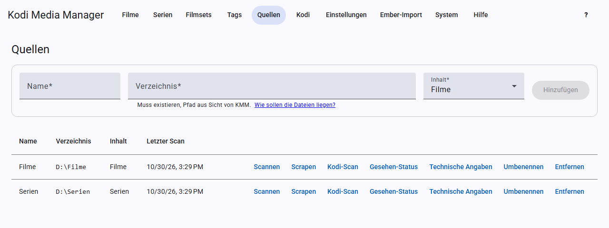

# Erste Schritte

So kommst du von der leeren Installation zur gepflegten Bibliothek.

**Kommst du von Ember Media Manager?** Dann fange mit dem [Ember-Import](ember-import.md) an. Er übernimmt Quellen, Filme, Serien, Einstellungen und Kodi-Geräte. Danach fehlen nur noch die API-Keys aus Schritt 1.

## 1. API-Keys eintragen

Für Online-Daten brauchst du kostenlose Keys der Anbieter. Trage sie unter [Einstellungen → API-Keys](settings.md#api-keys) ein. Für den Anfang genügen TMDB und, falls du Serien hast, TVDB.

## 2. Sprache einstellen

Lege unter [Einstellungen](settings.md#sprache) fest, in welcher Sprache Metadaten kommen sollen, zum Beispiel `de-DE`, und welche Bildsprache bevorzugt wird, zum Beispiel `de`. Für Filme und Serien gibt es dafür getrennte Felder. Speichere danach.

## 3. Quelle anlegen

Öffne **Quellen** und lege für jedes Medienverzeichnis eine Quelle an: Name, Verzeichnis und Inhalt (Filme oder Serien). Mehr dazu unter [Quellen und Scan](sources.md).

## 4. Scannen

Klicke bei der Quelle auf **Scannen**. KMM findet die Videos und liest vorhandene NFO-Dateien ein. Oben in der Seite siehst du den Fortschritt. Danach stehen die Einträge unter **Filme** bzw. **Serien**.

## 5. Daten holen

Klicke bei der Quelle auf **Scrapen**. KMM ergänzt für alle Einträge fehlende Metadaten und Bilder. Filme oder Serien ohne eindeutigen Treffer nennt dir ein Bericht, die suchst du dann einzeln, siehe [Scrapen](scraping.md). Kommt später ein einzelner neuer Film dazu, reicht **Scrapen** in seiner Ansicht.

## 6. Kontrollieren und korrigieren

Öffne einzelne Filme oder Serien und prüfe die Angaben. Änderungen übernimmst du mit **Speichern**. Mit den [Filtern](filters.md) findest du schnell, was noch fehlt, zum Beispiel „Ohne TMDB-ID“.

## 7. Kodi verbinden

Richte unter [Kodi](kodi.md) dein Kodi-Gerät ein, damit es Änderungen automatisch übernimmt.

## 8. Dateien ordnen (optional)

Wenn du einheitliche Namen möchtest, lege die Muster in den Einstellungen fest und benenne die Dateien um. Lies dafür vorher das Kapitel [Umbenennen](renaming.md).

## Laufende Aufgaben

Längere Arbeiten wie Scans laufen als Aufgabe im Hintergrund. Sie laufen weiter, wenn du die Seite wechselst. Unter der Kopfleiste siehst du die laufende Aufgabe und, ob weitere warten. Auf der Seite **Quellen** kannst du einen laufenden Scan oder ein laufendes Scrapen abbrechen.
