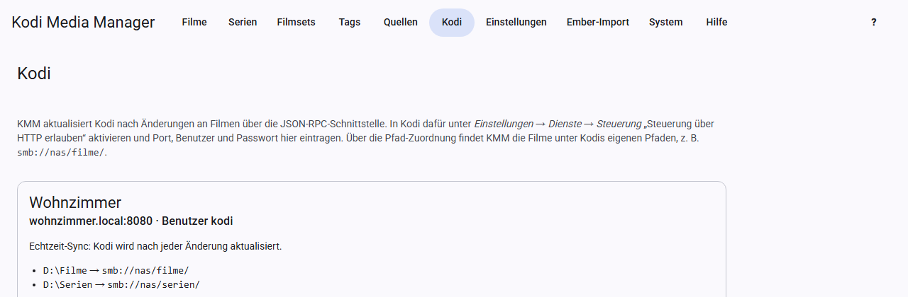

# Kodi

KMM hält deine Kodi-Geräte auf dem aktuellen Stand und holt den Gesehen-Status von ihnen.

## In Kodi vorbereiten

Öffne in Kodi *Einstellungen → Dienste → Steuerung* und aktiviere „Steuerung über HTTP erlauben“. Lege dort Port, Benutzer und Passwort fest.

## Gerät einrichten

Öffne **Kodi** und klicke auf **Kodi-Gerät hinzufügen**.

- **Name:** frei wählbar, zum Beispiel „Wohnzimmer“.
- **Adresse:** Rechnername oder IP-Adresse, ohne `http://`.
- **Port, Benutzer, Passwort:** wie in Kodi eingestellt. Beim Bearbeiten behält ein leeres Passwortfeld das gespeicherte Passwort.
- **Echtzeit-Sync:** siehe unten.

Prüfe die Einstellungen danach mit **Verbindung testen**. Das Ergebnis erscheint auf der Karte des Geräts. Kodi muss dafür laufen.

## Pfad-Zuordnung

KMM und Kodi sehen dieselben Dateien oft unter verschiedenen Pfaden. Die Zuordnung übersetzt zwischen beiden. **Ohne sie kann KMM keine Einträge in Kodi aktualisieren.**

| Pfad in KMM | Pfad in Kodi |
|---|---|
| `D:\Filme` | `smb://nas/filme/` |
| `/media/serien` | `nfs://nas/serien/` |

Lege für jede Quelle eine Zeile an. Den Pfad in Kodi siehst du dort unter *Videos → Dateien*.

**Verbindung testen** vergleicht die Zuordnung auch mit den Quellen in Kodi und warnt, wenn Kodi zu einem Pfad keine Quelle hat. Dieselbe Warnung erscheint, wenn KMM einen Scan außerhalb der Quellen startet, denn Kodi meldet in dem Fall keinen Fehler und liest nichts ein. Probleme beim Aktualisieren bleiben als Meldung stehen, bis du sie mit **OK** schließt. Eine abweichende Groß- und Kleinschreibung erkennt die Prüfung nicht.

## Echtzeit-Sync

Mit eingeschaltetem Echtzeit-Sync aktualisiert KMM Kodi nach jeder Änderung selbst:

- Geänderter Film, geänderte Serie oder Episode: Kodi liest den Eintrag neu ein. Eine geänderte Serie liest Kodi ohne ihre Episoden neu ein.
- Kennt Kodi den Eintrag noch nicht: Kodi durchsucht seinen Ordner.
- Neue Einträge nach einem Scan: Kodi durchsucht die Quelle.

Mehrere Änderungen kurz hintereinander lösen nur eine Aktualisierung aus, KMM wartet dafür einige Sekunden. Der letzte Abgleich steht auf der Karte des Geräts.

Entfernst du Filme, Serien, Staffeln oder Episoden mit den Knöpfen **Entfernen** (siehe [Filme](movies.md#remove) und [Serien](tv-shows.md#remove)), entfernt KMM sie auch aus Kodi. Einträge, die nur durch einen Scan oder das Entfernen einer Quelle aus KMM verschwinden, bleiben in Kodi, bis dort die Bibliothek bereinigt wird.

## Von Hand aktualisieren

- **In Kodi aktualisieren** in Film-, Serien- und Episodenansicht wirkt auf alle Geräte.
- In der Serienansicht liest Kodi die Serie und jede ihrer Episoden neu ein. Dasselbe gibt es je Staffel, dann nur für deren Episoden. KMM schickt jede Episode einzeln an Kodi, so behält Kodi Gesehen-Status und Wiedergabe-Positionen. Episoden, die Kodi noch nicht kennt, holt ein Scan des Serienordners. Den Fortschritt zeigt KMM oben in der Serienansicht, das Ergebnis je Gerät als Meldung.
- **In Kodi aktualisieren** in der Film- und Serienliste macht dasselbe für die Auswahl, bei Serien ebenfalls mit allen Episoden. Antwortet ein Gerät nicht, überspringt KMM es für den Rest des Laufs.
- **In Kodi scannen** in der Serienansicht lässt alle Geräte den Serienordner nach neuen Episoden durchsuchen. Danach entfernt Kodi Einträge aus diesem Ordner, deren Dateien fehlen. Bekannte Episoden liest Kodi dabei nicht neu ein, das macht **In Kodi aktualisieren**. Bei einer Staffel durchsucht Kodi nur deren Ordner, wenn alle ihre Episoden in einem gemeinsamen Unterordner liegen und Kodi diesen schon kennt. Sonst durchsucht Kodi den ganzen Serienordner, denn einen unbekannten Staffelordner hielte Kodi für eine eigene Serie. In der Serienliste gibt es denselben Knopf für die Auswahl.
- **Kodi-Scan** bei einer [Quelle](sources.md) lässt alle Geräte die Quelle durchsuchen.

All das funktioniert auch ohne Echtzeit-Sync.

## Wenn Kodi gerade einliest

Kodi kann nur einen Scan oder eine Bereinigung gleichzeitig ausführen. KMM startet deshalb erst, wenn Kodi fertig ist:

- **Knöpfe** warten höchstens 10 Sekunden. Ist Kodi dann noch beschäftigt, meldet KMM das, und du versuchst es danach noch einmal.
- **Stapel-Bearbeitung und Echtzeit-Sync** warten bis zu 30 Minuten. Während dieser Zeit stehen weitere Abgleiche an.

## Gesehen-Status holen

**Gesehen-Status** bei einer Quelle und **Gesehen-Status aus Kodi** in den Ansichten holen Wiedergaben, letzte Wiedergabe und eigene Bewertung. KMM schreibt sie in Datenbank und NFO, damit Kodi sie beim Neueinlesen nicht verliert.

Es werden nur mehr Wiedergaben, neuere Daten und Bewertungen ergänzt, nie etwas zurückgesetzt.

## Mehrere Geräte

Du kannst beliebig viele Geräte anlegen. Teilen sie sich dieselbe Kodi-Datenbank, genügt für den Gesehen-Status ein Gerät.

Läuft ein Gerät gerade nicht, schalte es mit dem Schalter **Eingeschaltet** auf seiner Karte aus. KMM spricht es dann nicht mehr an, weder beim Echtzeit-Sync noch beim Aktualisieren oder Scannen von Hand noch beim Holen des Gesehen-Status. So kommt keine Meldung „nicht erreichbar“. Die Einstellungen und die Pfad-Zuordnung bleiben erhalten, und **Verbindung testen** funktioniert weiterhin. Ein neues Gerät ist eingeschaltet.

Kodi wird immer ohne den Proxy aus den Einstellungen angesprochen.
