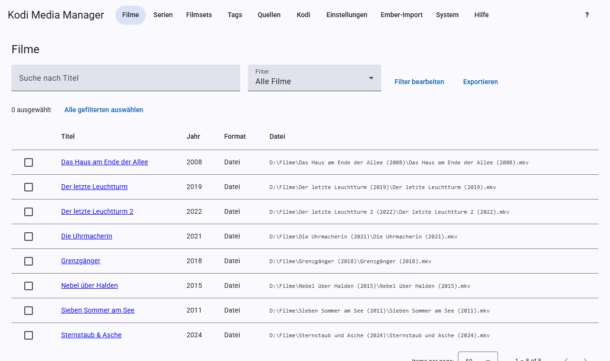
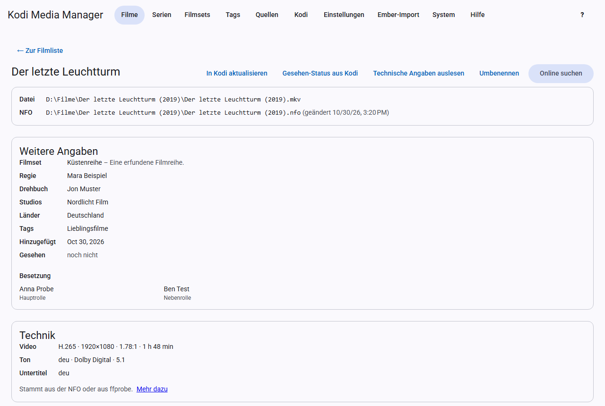

# Filme

## Die Filmliste

Die Seite **Filme** zeigt alle Filme mit Titel, Jahr, Format, Hinzugefügt und Datei. Ein Klick auf einen Spaltenkopf sortiert die Liste danach, ein zweiter dreht die Richtung um. So siehst du zum Beispiel mit **Hinzugefügt** die neuesten Filme zuerst. Die Seitenleiste steht über und unter der Liste. Oben kannst du nach dem Titel suchen und einen [Filter](filters.md) wählen. Über die Häkchen links wählst du Filme für [Stapel-Aktionen](filters.md#batch-edit) aus, und über **Exportieren** lädst du die aktuelle Liste als [Export](export.md) herunter.

## Die Filmansicht

Ein Klick auf den Titel öffnet die Filmansicht. Sie zeigt von oben nach unten:

- **Datei und NFO:** wo der Film und seine NFO liegen. Gibt es noch keine NFO, legt KMM sie beim Speichern an.
- **Weitere Angaben:** Filmset, Bewertungen, Regie, Drehbuch, Studios, Länder, Tags, Gesehen-Status und Besetzung.
- **Technik:** Video, Ton und Untertitel.
- **Trailer**, **Titelmusik** und **Bilder**, siehe [Scrapen](scraping.md).
- **Formular:** die Angaben, die du direkt bearbeiten kannst.

## Angaben bearbeiten

Ändere die Felder im Formular und klicke auf **Speichern**. KMM schreibt dann die NFO und aktualisiert Kodi, wenn der [Echtzeit-Sync](kodi.md#real-time-sync) eingeschaltet ist. **Verwerfen** stellt den gespeicherten Stand wieder her.

Einige Felder im Detail:

- **Sortiertitel:** bestimmt die Reihenfolge in Kodi, zum Beispiel „Pate, Der“ für „Der Pate“.
- **Fassung:** zum Beispiel „Director's Cut“. Lässt sich im Dateinamen verwenden und filtern.
- **Videoquelle:** zum Beispiel `bluray` oder `dvd`. Auch nutzbar im Dateinamen, Platzhalter `{source}`.
- **Altersfreigabe:** zum Beispiel „FSK 16“.
- **IMDb-ID:** `tt` und 7 bis 10 Ziffern. Mehrere Anbieter finden den Film darüber. Ohne sie gibt es keine Ergänzungen von Moviepilot, OFDb und OMDb.
- **TMDB-ID:** nur Ziffern.
- **Genres:** mehrere durch Komma trennen.

## Knöpfe der Filmansicht

| Knopf | Was passiert |
|---|---|
| **In Kodi aktualisieren** | Kodi liest diesen Film sofort neu ein. |
| **Gesehen-Status aus Kodi** | Holt Wiedergaben und eigene Bewertung aus Kodi. |
| **Technische Angaben auslesen** | Liest die Datei mit ffprobe aus. |
| **Umbenennen** | Benennt nur diesen Film nach den Mustern der Einstellungen um. |
| **Scrapen** | Ergänzt alles Fehlende nur für diesen Film, siehe [Scrapen](scraping.md#automatisches-scrapen). |
| **Online suchen** | Sucht den Film bei einem Anbieter, siehe [Scrapen](scraping.md#online-suche). |
| **Entfernen** | Entfernt den Film, siehe [Entfernen](movies.md#remove). |

## Technische Angaben

Die Karte **Technik** zeigt Codec, Auflösung, Seitenverhältnis, Laufzeit, HDR, Tonspuren und Untertitel. Die Angaben stammen aus der NFO oder aus ffprobe. Dafür muss FFmpeg installiert sein, siehe [Installation](installation.md#zusatzprogramme). Du kannst sie auslesen

- einzeln mit **Technische Angaben auslesen**,
- für eine ganze Quelle unter [Quellen](sources.md),
- für alle Episoden einer Staffel in der Serienansicht, siehe [Eine Staffel scrapen](tv-shows.md#eine-staffel-scrapen),
- und automatisch nach dem Scrapen und nach dem Scan neuer Dateien, siehe [Einstellungen](settings.md#technische-angaben).

Beim Schreiben ersetzt KMM in der NFO nur diesen technischen Teil, der Rest der Datei bleibt unverändert.

## Entfernen

Einen Film entfernst du mit **Entfernen** in der Filmansicht, mehrere über die Häkchen in der Filmliste und **Auswahl entfernen**. KMM zeigt vorher die betroffenen Filme und fragt, wie entfernt werden soll:

- **Nur aus der Bibliothek** (Vorgabe): Die Filme verschwinden aus KMM und, mit eingeschaltetem [Echtzeit-Sync](kodi.md#real-time-sync), aus Kodi. Die Dateien bleiben liegen, und KMM merkt sich nichts. Der nächste Scan der Quelle nimmt sie wieder auf.
- **Auch Dateien löschen:** Zusätzlich löscht KMM die Dateien endgültig, ohne Papierkorb. Die Rückfrage listet jede Datei auf, der Knopf heißt dann **Endgültig löschen**.

Was gelöscht wird:

- die Filmdatei, bei mehrteiligen Filmen (`-cd1`, `-part2` …) alle Teile,
- alles, was den Namen des Films trägt, gefolgt von Punkt, Bindestrich, Unterstrich oder Leerzeichen: NFO, Bilder, Untertitel, Trailer,
- bei einem Film im eigenen Ordner auch `movie.nfo`; der Ordner selbst verschwindet, wenn danach nichts mehr darin liegt. Sonst nennt ein Hinweis, wie viele andere Dateien ihn erhalten,
- bei DVD- und Blu-ray-Ordnern (`VIDEO_TS`, `BDMV`) der ganze Filmordner.

Liegen mehrere Filme in einem Ordner, löscht KMM nur die Dateien des gewählten Films. Leere Ordner darüber räumt es bis zur Quelle auf. Die Quelle selbst und alles außerhalb von ihr löscht KMM nie. Eine Datei, die sich nicht löschen lässt, steht am Ende in der Meldung; die übrigen Dateien und die Einträge sind dann trotzdem weg. Ein Filmset bleibt bestehen, auch wenn es danach keine Filme mehr hat.

## Gesehen-Status

KMM holt den Status aus Kodi, nicht umgekehrt. Kodi ergänzt dabei nur mehr Wiedergaben, neuere Daten oder eine Bewertung und setzt nichts zurück.
