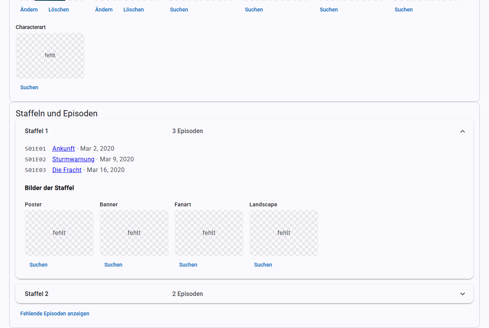

# Serien und Episoden

## Die Serienliste

Die Seite **Serien** funktioniert wie die [Filmliste](movies.md#die-filmliste), mit Suche, [Filtern](filters.md), Auswahl, [Export](export.md), Sortierung über die Spaltenköpfe und Seitenleiste über und unter der Liste. Wie die Filmliste merkt sie sich Seite, Filter und Position, wenn du aus einer Serie oder Episode zurückkommst.

## Die Serienansicht

Ein Klick auf den Titel öffnet die Serie:

- **Ordner und NFO:** wo die Serie und ihre `tvshow.nfo` liegen.
- **Trailer**, **Titelmusik** und **Bilder der Serie**, siehe [Scrapen](scraping.md).
- **Staffeln und Episoden:** zum Aufklappen, mit den Bildern jeder Staffel.
- **Weitere Angaben:** Besetzung und Bewertungen.
- **Formular:** die Angaben der Serie.

Das Formular speicherst du wie bei Filmen mit **Speichern**. Zusätzlich gibt es **Status** (`Continuing` für laufend, `Ended` für beendet), **Sender/Studios** und **Tags**, jeweils durch Komma getrennt.

### Fehlende Episoden

**Fehlende Episoden anzeigen** fragt den Anbieter, welche Episoden es gibt, für die du keine Datei hast. Das ist nur eine Anzeige, KMM legt dafür nichts an.

### Episoden-Reihenfolge

Manche Serien zählen Staffeln und Episoden je nach Anbieter verschieden. Eine erfundene Serie „Der große Coup“ hat bei der Ausstrahlung im Fernsehen zwei Staffeln mit je 15 Episoden, beim Streamingdienst aber vier Teile mit kürzeren Episoden. KMM ordnet die Angaben des Anbieters über die Staffel- und Episodennummer im Dateinamen zu. Die Zählung muss deshalb zu deinen Dateien passen.

Unter **Episoden-Reihenfolge** in der Serienansicht wählst du die Zählung für diese Serie. Beim Öffnen der Liste fragt KMM die Anbieter, welche Zählweisen sie für die Serie kennen:

- **TVDB** bietet z. B. „Aired Order“ (Ausstrahlung), „DVD Order“, „Absolute Order“ oder die Zählung eines Streamingdienstes wie „Netflix Order“.
- **TMDB** bietet die Ausstrahlung und sogenannte Episodengruppen, z. B. „Netflix Order (Digital)“.

Hat die Serie einen eigenen [Scraper](tv-shows.md#own-scraper), bietet KMM nur dessen Zählweisen an und sucht die Serie dort, falls sie noch nicht zugeordnet ist. Sonst kommen nur Anbieter infrage, bei denen die Serie schon zugeordnet ist. Ist sie das noch nicht, scrapst du sie zuerst. Kennt ein Anbieter für die Serie keine andere Zählweise, steht das in der Liste. Bei TMDB ist das oft so, denn Episodengruppen gibt es nur für manche Serien. **Standard-Zählweise** steht im Abschnitt des Scrapers der Serie und nimmt wieder dessen übliche Zählung; ist sie gewählt, zeigt das Feld „Standard-Zählweise von …“ mit dem Namen des Scrapers; bei TheTVDB ist das die Reihenfolge aus den [Einstellungen](settings.md#serien).

Nach der Auswahl fragt KMM, ob es Titel und Inhaltsangaben aller Episoden gleich in der neuen Zählung neu holen soll. **OK** überschreibt die vorhandenen Texte, auch von Hand geänderte. **Abbrechen** ändert nur die Reihenfolge, sie gilt dann ab dem nächsten Scrapen. Die Dateien selbst benennt KMM dabei nicht um.

Mit einer eigenen Reihenfolge scrapt KMM die Serie immer beim Anbieter dieser Reihenfolge, auch wenn in den Einstellungen ein anderer bevorzugt ist. Die Reihenfolge steht nur in der Datenbank von KMM, nicht in der NFO, denn Kodi kennt dafür kein Feld.

### Scraper der Serie

Normalerweise holt KMM die Daten einer Serie beim ersten Anbieter in der Reihenfolge ihrer [Quelle](sources.md#source-scrapers). Passt bei einer einzelnen Serie keine Zählung dieses Anbieters zu deinen Dateien, wählst du unter **Scraper** in der Serienansicht einen anderen. Ein Beispiel: Die erfundene Serie „Im Nebelwald“ hat bei TVDB zwei Zählweisen, aber deine Dateien folgen der von TMDB. Dann wählst du TMDB.

Nach der Auswahl fragt KMM, ob es die Serie gleich beim neuen Anbieter zuordnen und Titel und Inhaltsangaben der Serie und aller Episoden neu holen soll. **OK** überschreibt die vorhandenen Texte, auch von Hand geänderte. **Abbrechen** ändert nur den Scraper, er gilt ab dem nächsten Scrapen. Findet der Anbieter die Serie nicht eindeutig, meldet KMM das; dann hilft die [Online-Suche](tv-shows.md#online-suche-für-serien).

Eine Episoden-Reihenfolge eines anderen Anbieters entfällt dabei, ihre Nummern gehören zu ihm. Wählst du umgekehrt eine Episoden-Reihenfolge eines anderen Anbieters, wechselt auch der Scraper. **Standard der Quelle** setzt die Wahl zurück. Der Scraper steht wie die Reihenfolge nur in der Datenbank von KMM.

## Eine Serie oder Staffel scannen

Hast du neue Episoden in den Ordner einer Serie gelegt oder welche gelöscht, musst du nicht die ganze Quelle scannen. **Scannen** oben in der Serienansicht liest nur den Ordner dieser Serie neu ein: Neue Episoden kommen dazu, Episoden ohne Datei werden aus der Bibliothek entfernt, und geänderte NFOs werden übernommen. **Scannen** bei einer Staffel macht dasselbe nur für die Episoden dieser Staffel. In der Serienliste scannst du so mehrere ausgewählte Serien auf einmal.

Danach geht es weiter wie nach dem [Scan einer Quelle](sources.md): Die technischen Angaben neuer Episoden werden ausgelesen, die Serie wird bei Bedarf umbenannt, und Kodi-Geräte mit [Echtzeit-Sync](kodi.md#echtzeit-sync) durchsuchen den Ordner der Serie oder Staffel.

Ist der Ordner nicht erreichbar oder enthält er keine Videodateien mehr, meldet KMM das und entfernt nichts. Eine Serie, die es nicht mehr gibt, entfernst du über [Entfernen](tv-shows.md#entfernen).

## Eine Serie scrapen

**Scrapen** in der Serienansicht ergänzt alles Fehlende nur für diese Serie, auch leere Episodenfelder, siehe [Scrapen](scraping.md#automatisches-scrapen).

## Eine Staffel scrapen

Klappst du unter **Staffeln und Episoden** eine Staffel auf, findest du zwei Knöpfe:

- **Staffel scrapen** arbeitet wie **Scrapen**, aber nur für diese Staffel. Es füllt leere Felder ihrer Episoden und holt fehlende Bilder der Staffel und Standbilder ihrer Episoden.
- **Staffel neu holen** ersetzt Titel und Inhaltsangaben der Episoden durch die des Anbieters, auch von Hand geänderte. Deshalb fragt KMM vorher nach. Was der Anbieter nicht hat, bleibt. Vorhandene Bilder ersetzt es nicht.

Beide Knöpfe ergänzen außerdem den Titel der Staffel, **Staffel neu holen** ersetzt ihn. Die übrigen Angaben der Serie bleiben unverändert. Trailer, Titelmusik und Bewertungen gehören zur ganzen Serie und kommen nur über **Scrapen**. Ist eine Serie noch nicht zugeordnet, übernimmt **Staffel scrapen** sie wie **Scrapen** nur bei eindeutigem Treffer. **Staffel neu holen** braucht eine zugeordnete Serie.

Ist das Auslesen technischer Angaben beim Scrapen eingeschaltet, liest KMM nach Änderungen die Episoden der Staffel aus, die noch keine technischen Angaben haben. Ist [Umbenennen nach dem Scrapen](settings.md) eingeschaltet, benennt es Staffelordner und Episodendateien dieser Staffel um, der Serienordner bleibt.

Fortschritt und Bericht erscheinen oben in der Serienansicht. Solange eine Staffel oder die Serie gescrapt wird, sind alle Scrapen-Knöpfe der Serie gesperrt.

**Technische Angaben auslesen** liest alle Episoden der Staffel mit ffprobe neu aus, auch solche, die schon Angaben haben. Sprachen der Spuren aus der NFO bleiben dabei erhalten, wie bei den [technischen Angaben](movies.md#technical-details) von Filmen. Den Fortschritt zeigt KMM über den Staffeln, das Ergebnis als Meldung. Solange das läuft, sind die Scrapen-Knöpfe der Serie gesperrt, denn beide schreiben in dieselben NFOs.

**In Kodi aktualisieren** bei einer Staffel lässt Kodi alle Episoden dieser Staffel neu einlesen; der Knopf oben in der Serienansicht macht das für die Serie und alle Episoden. **In Kodi scannen** lässt Kodi im Ordner der Staffel oder Serie nach neuen Episoden suchen und danach Einträge entfernen, deren Dateien fehlen (siehe [Kodi](kodi.md#von-hand-aktualisieren)).

## Online-Suche für Serien

**Online suchen** arbeitet wie bei [Filmen](scraping.md#online-suche). Vorgewählt ist der Scraper der Serie. Übernimmst du einen Treffer eines anderen Anbieters als des Standards der Quelle, merkt sich die Serie diesen Anbieter als ihren [Scraper](tv-shows.md#own-scraper). Die übernommenen Angaben landen zuerst im Formular. Beim Speichern ergänzt KMM zusätzlich die Episoden, und zwar nur deren leere Felder. Ein Hinweis über den Knöpfen sagt dir vorher, wie viele Episoden betroffen sind.

Welche Reihenfolge der Episoden gilt (Ausstrahlung, DVD oder absolut), stellst du unter [Einstellungen](settings.md#serien) ein. Das wirkt nur bei TVDB. Andere Zählweisen, etwa die eines Streamingdienstes, wählst du pro Serie unter [Episoden-Reihenfolge](tv-shows.md#episode-order).

## Die Episodenansicht

Ein Klick auf eine Episode öffnet ihre Ansicht mit Datei, NFO, Standbild, technischen Angaben und einem Formular. Dort gibt es auch **In Kodi aktualisieren**, **Gesehen-Status aus Kodi** und **Technische Angaben auslesen**.

**Scrapen** und **Neu holen** arbeiten wie **Staffel scrapen** und **Staffel neu holen** (siehe [Eine Staffel scrapen](tv-shows.md#scrape-season)), aber nur für diese Episode: **Scrapen** füllt leere Felder und holt ein fehlendes Standbild, **Neu holen** ersetzt nach einer Rückfrage Titel und Inhaltsangabe durch die des Anbieters. Die Serie und ihre Staffeln bleiben unverändert. Ist das Umbenennen beim Scrapen eingeschaltet, prüft KMM danach die Dateinamen der ganzen Staffel.

Teilen sich mehrere Episoden eine Datei, schreibt KMM die NFO für alle Episoden dieser Datei.

## Entfernen

Episoden, Staffeln und ganze Serien entfernst du mit den Knöpfen **Entfernen** in der Episodenansicht, **Staffel entfernen** in einer aufgeklappten Staffel und **Serie entfernen** oben in der Serienansicht. KMM zeigt vorher, welche Einträge betroffen sind, und fragt, wie entfernt werden soll:

- **Nur aus der Bibliothek** (Vorgabe): Die Einträge verschwinden aus KMM und, mit eingeschaltetem [Echtzeit-Sync](kodi.md#real-time-sync), aus Kodi. Die Dateien bleiben liegen, und KMM merkt sich nichts. Der nächste Scan der Quelle nimmt sie wieder auf.
- **Auch Dateien löschen:** Zusätzlich löscht KMM die Dateien endgültig, ohne Papierkorb. Die Rückfrage listet jede Datei auf, der Knopf heißt dann **Endgültig löschen**.

Was gelöscht wird:

| Was | Dateien |
|---|---|
| Episode | die Videodatei mit allem, was ihren Namen trägt, gefolgt von Punkt, Bindestrich, Unterstrich oder Leerzeichen: NFO, Standbild (`-thumb.jpg`), Untertitel |
| Staffel | alle Episodendateien der Staffel wie oben und die Staffelbilder im Serienordner (`season01-poster.jpg` usw.) |
| Serie | der ganze Serienordner mit allem darin. Dateien, die KMM nicht kennt, nennt die Rückfrage eigens. |

**Mehrfachepisoden:** Enthält eine Datei mehrere Episoden (z. B. `S01E02E03`), entfernt KMM immer die ganze Datei mit allen ihren Episoden, auch wenn du nur eine davon gewählt hast. Die Rückfrage nennt alle betroffenen Episoden. Reicht eine solche Datei in eine andere Staffel, gehen deren Episoden mit, und ein Hinweis sagt das.

Ordner, die danach leer sind, entfernt KMM ebenfalls, bei Episoden und Staffeln bis zum Serienordner, bei einer Serie bis zur Quelle. Die Quelle selbst und alles außerhalb von ihr löscht KMM nie. Ist eine Serie die Quelle selbst, geht nur **Nur aus der Bibliothek**. Eine Datei, die sich nicht löschen lässt, steht am Ende in der Meldung; die übrigen Dateien und die Einträge sind dann trotzdem weg.

## Bilder bei Serien

| Wofür | Bildarten | Dateien |
|---|---|---|
| Serie | Poster, Fanart, Banner, Clearlogo, Clearart, Landscape, Characterart | `poster.jpg` usw. im Serienordner |
| Staffel | Poster, Banner, Fanart, Landscape | `season01-poster.jpg`, `season-specials-poster.jpg` im Serienordner |
| Episode | Standbild | `<episode>-thumb.jpg` neben der Episode |
