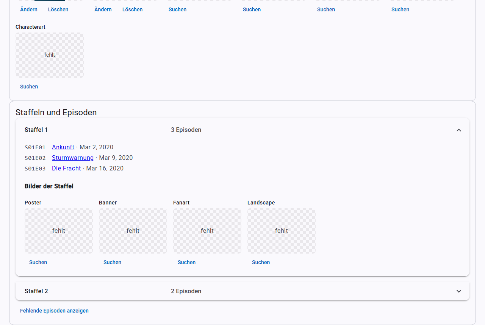

# Serien und Episoden

## Die Serienliste

Die Seite **Serien** funktioniert wie die [Filmliste](movies.md#die-filmliste), mit Suche, [Filtern](filters.md), Auswahl, [Export](export.md), Sortierung über die Spaltenköpfe und Seitenleiste über und unter der Liste.

## Die Serienansicht

Ein Klick auf den Titel öffnet die Serie:

- **Ordner und NFO:** wo die Serie und ihre `tvshow.nfo` liegen.
- **Trailer**, **Titelmusik** und **Bilder der Serie**, siehe [Scrapen](scraping.md).
- **Staffeln und Episoden:** zum Aufklappen, mit den Bildern jeder Staffel.
- **Weitere Angaben:** Besetzung und Bewertungen.
- **Formular:** die Angaben der Serie.

Das Formular speicherst du wie bei Filmen mit **Speichern**. Zusätzlich gibt es **Status** (`Continuing` für laufend, `Ended` für beendet), **Sender/Studios** und **Tags**, jeweils durch Komma getrennt.

### Fehlende Episoden

**Fehlende Episoden anzeigen** fragt den Anbieter, welche Episoden es gibt, für die du keine Datei hast. Das ist nur eine Anzeige, KMM legt dafür nichts an.

## Eine Serie oder Staffel scannen

Hast du neue Episoden in den Ordner einer Serie gelegt oder welche gelöscht, musst du nicht die ganze Quelle scannen. **Scannen** oben in der Serienansicht liest nur den Ordner dieser Serie neu ein: Neue Episoden kommen dazu, Episoden ohne Datei werden aus der Bibliothek entfernt, und geänderte NFOs werden übernommen. **Scannen** bei einer Staffel macht dasselbe nur für die Episoden dieser Staffel. In der Serienliste scannst du so mehrere ausgewählte Serien auf einmal.

Danach geht es weiter wie nach dem [Scan einer Quelle](sources.md): Die technischen Angaben neuer Episoden werden ausgelesen, die Serie wird bei Bedarf umbenannt, und Kodi-Geräte mit [Echtzeit-Sync](kodi.md#echtzeit-sync) durchsuchen den Ordner der Serie oder Staffel.

Ist der Ordner nicht erreichbar oder enthält er keine Videodateien mehr, meldet KMM das und entfernt nichts. Eine Serie, die es nicht mehr gibt, entfernst du über [Entfernen](tv-shows.md#entfernen).

## Eine Serie scrapen

**Scrapen** in der Serienansicht ergänzt alles Fehlende nur für diese Serie, auch leere Episodenfelder, siehe [Scrapen](scraping.md#automatisches-scrapen).

## Eine Staffel scrapen

Klappst du unter **Staffeln und Episoden** eine Staffel auf, findest du zwei Knöpfe:

- **Staffel scrapen** arbeitet wie **Scrapen**, aber nur für diese Staffel. Es füllt leere Felder ihrer Episoden und holt fehlende Bilder der Staffel und Standbilder ihrer Episoden.
- **Staffel neu holen** ersetzt Titel und Inhaltsangaben der Episoden durch die des Anbieters, auch von Hand geänderte. Deshalb fragt KMM vorher nach. Was der Anbieter nicht hat, bleibt. Vorhandene Bilder ersetzt es nicht.

Beide Knöpfe ergänzen außerdem den Titel der Staffel, **Staffel neu holen** ersetzt ihn. Die übrigen Angaben der Serie bleiben unverändert. Trailer, Titelmusik und Bewertungen gehören zur ganzen Serie und kommen nur über **Scrapen**. Ist eine Serie noch nicht zugeordnet, übernimmt **Staffel scrapen** sie wie **Scrapen** nur bei eindeutigem Treffer. **Staffel neu holen** braucht eine zugeordnete Serie.

Ist das Auslesen technischer Angaben beim Scrapen eingeschaltet, liest KMM nach Änderungen die Episoden der Staffel aus, die noch keine technischen Angaben haben. Ist [Umbenennen nach dem Scrapen](settings.md) eingeschaltet, benennt es Staffelordner und Episodendateien dieser Staffel um, der Serienordner bleibt.

Fortschritt und Bericht erscheinen oben in der Serienansicht. Solange eine Staffel oder die Serie gescrapt wird, sind alle Scrapen-Knöpfe der Serie gesperrt.

**Technische Angaben auslesen** liest alle Episoden der Staffel mit ffprobe neu aus, auch solche, die schon Angaben haben. Sprachen der Spuren aus der NFO bleiben dabei erhalten, wie bei den [technischen Angaben](movies.md#technical-details) von Filmen. Den Fortschritt zeigt KMM über den Staffeln, das Ergebnis als Meldung. Solange das läuft, sind die Scrapen-Knöpfe der Serie gesperrt, denn beide schreiben in dieselben NFOs.

**In Kodi aktualisieren** bei einer Staffel lässt Kodi alle Episoden dieser Staffel neu einlesen; der Knopf oben in der Serienansicht macht das für die Serie und alle Episoden. **In Kodi scannen** lässt Kodi im Ordner der Staffel oder Serie nach neuen Episoden suchen und danach Einträge entfernen, deren Dateien fehlen (siehe [Kodi](kodi.md#von-hand-aktualisieren)).

## Online-Suche für Serien

**Online suchen** arbeitet wie bei [Filmen](scraping.md#online-suche). Die Vorgabe ist TVDB. Die übernommenen Angaben landen zuerst im Formular. Beim Speichern ergänzt KMM zusätzlich die Episoden, und zwar nur deren leere Felder. Ein Hinweis über den Knöpfen sagt dir vorher, wie viele Episoden betroffen sind.

Welche Reihenfolge der Episoden gilt (Ausstrahlung, DVD oder absolut), stellst du unter [Einstellungen](settings.md#serien) ein. Das wirkt nur bei TVDB, TMDB kennt nur die Ausstrahlungsreihenfolge.

## Die Episodenansicht

Ein Klick auf eine Episode öffnet ihre Ansicht mit Datei, NFO, Standbild, technischen Angaben und einem Formular. Dort gibt es auch **In Kodi aktualisieren**, **Gesehen-Status aus Kodi** und **Technische Angaben auslesen**.

Teilen sich mehrere Episoden eine Datei, schreibt KMM die NFO für alle Episoden dieser Datei.

## Entfernen

Episoden, Staffeln und ganze Serien entfernst du mit den Knöpfen **Entfernen** in der Episodenansicht, **Staffel entfernen** in einer aufgeklappten Staffel und **Serie entfernen** oben in der Serienansicht. KMM zeigt vorher, welche Einträge betroffen sind, und fragt, wie entfernt werden soll:

- **Nur aus der Bibliothek** (Vorgabe): Die Einträge verschwinden aus KMM und, mit eingeschaltetem [Echtzeit-Sync](kodi.md#real-time-sync), aus Kodi. Die Dateien bleiben liegen, und KMM merkt sich nichts. Der nächste Scan der Quelle nimmt sie wieder auf.
- **Auch Dateien löschen:** Zusätzlich löscht KMM die Dateien endgültig, ohne Papierkorb. Die Rückfrage listet jede Datei auf, der Knopf heißt dann **Endgültig löschen**.

Was gelöscht wird:

| Was | Dateien |
|---|---|
| Episode | die Videodatei mit allem, was ihren Namen trägt, gefolgt von Punkt, Bindestrich, Unterstrich oder Leerzeichen: NFO, Standbild (`-thumb.jpg`), Untertitel |
| Staffel | alle Episodendateien der Staffel wie oben und die Staffelbilder im Serienordner (`season01-poster.jpg` usw.) |
| Serie | der ganze Serienordner mit allem darin. Dateien, die KMM nicht kennt, nennt die Rückfrage eigens. |

**Mehrfachepisoden:** Enthält eine Datei mehrere Episoden (z. B. `S01E02E03`), entfernt KMM immer die ganze Datei mit allen ihren Episoden, auch wenn du nur eine davon gewählt hast. Die Rückfrage nennt alle betroffenen Episoden. Reicht eine solche Datei in eine andere Staffel, gehen deren Episoden mit, und ein Hinweis sagt das.

Ordner, die danach leer sind, entfernt KMM ebenfalls, bei Episoden und Staffeln bis zum Serienordner, bei einer Serie bis zur Quelle. Die Quelle selbst und alles außerhalb von ihr löscht KMM nie. Ist eine Serie die Quelle selbst, geht nur **Nur aus der Bibliothek**. Eine Datei, die sich nicht löschen lässt, steht am Ende in der Meldung; die übrigen Dateien und die Einträge sind dann trotzdem weg.

## Bilder bei Serien

| Wofür | Bildarten | Dateien |
|---|---|---|
| Serie | Poster, Fanart, Banner, Clearlogo, Clearart, Landscape, Characterart | `poster.jpg` usw. im Serienordner |
| Staffel | Poster, Banner, Fanart, Landscape | `season01-poster.jpg`, `season-specials-poster.jpg` im Serienordner |
| Episode | Standbild | `<episode>-thumb.jpg` neben der Episode |
