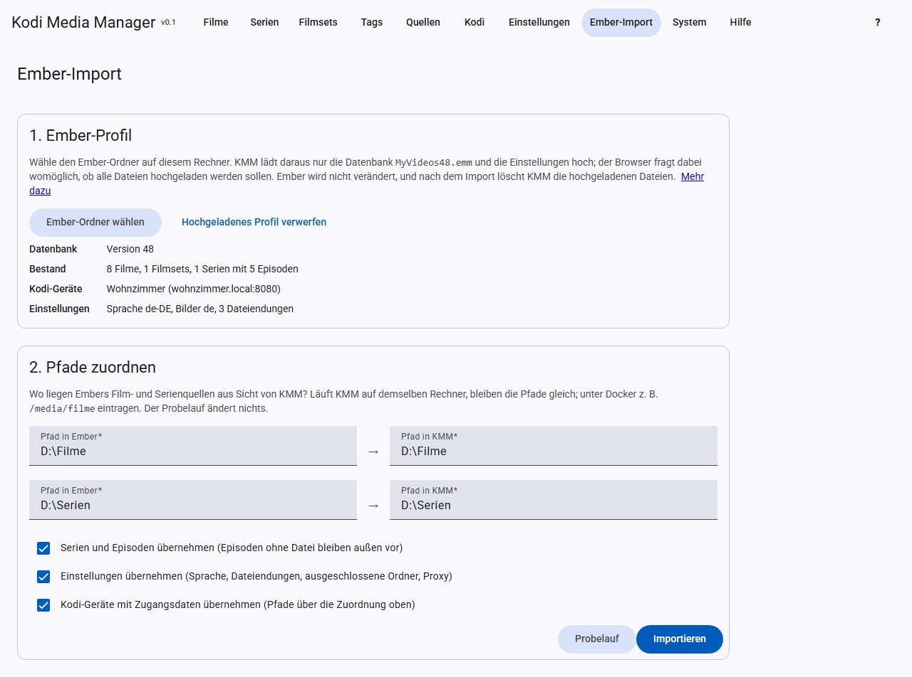

# Ember import

The wizard takes over your library from Ember Media Manager. **Your Ember profile is only read**; NFOs and artwork stay unchanged as well. Database version 48 (`MyVideos48.emm`) is supported. Open older profiles once with the latest Ember version beforehand; it updates them itself.

## 1. Upload the profile

Click **Choose Ember folder** and choose the Ember installation folder or the `Profiles\Default` folder on your computer. KMM does not have to run on the same computer as Ember. Your browser may ask whether all files of the folder should be uploaded; however, only the newest database (`MyVideos48.emm`), `Settings.xml`, `AdvancedSettings.xml` and `Interface.Kodi.xml` are uploaded.

KMM then shows you what it found: movies, movie sets, TV shows, episodes, Kodi devices and settings.

**Credentials:** these files contain the credentials of your Kodi devices. They are sent over the same connection as the interface, so without HTTPS they are unencrypted. This is acceptable in your home network, but do not upload the profile over the internet without HTTPS. **Discard uploaded profile** deletes the files on the server immediately; the import and a restart of KMM delete them as well.

## 2. Map paths

Here you enter where Ember’s sources are located as KMM sees them. If KMM runs on the same computer as Ember, the paths stay the same. Under Docker, for example, `D:\Filme` becomes `/media/filme`.

Below that, you choose what to take over:

- **TV shows and episodes:** episodes without a file are left out.
- **Languages:** those of every source, movie and TV show, see [Language per entry](scraping.md#language-per-source-and-entry). An existing source keeps its own language. Entries that were already imported get it through a new import.
- **Settings:** language, file extensions, excluded folders and proxy. The proxy password is not taken over.
- **Kodi devices** with credentials. Their paths go through the mapping above.

## 3. Dry run and import

First click **Dry run**. It runs the import completely and then undoes it. So the report shows exactly what the import would change.

If everything looks right, click **Import**. After the import, KMM deletes the uploaded profile, even if the import fails or you cancel it. The dry run keeps it for the import that follows.

## The report

It counts new, updated and skipped entries and lists

- the changed **settings**,
- **sources not imported**,
- **notes**, for example if a movie was in several sets: Kodi only knows one, and the first one is taken,
- **movies without a found NFO**: usually the directory is not reachable right now or the mapping is wrong. The details from Ember have been taken over anyway.

## Good to know

- **Ember wins:** metadata comes from Ember’s database. The NFO then counts as read, so that the next scan does not overwrite the Ember data.
- **Repeatable:** importing again updates entries instead of duplicating them. This only works with the same paths, though. If you change the mapping, the entries are created twice; in that case clear the database first, see [Starting over](troubleshooting.md#starting-over).
- **Conversion:** certifications such as `Germany:16` become `FSK 16`.
- **Custom movie lists** from Ember become saved [filters](filters.md), as far as they can be translated.
- **Renaming patterns** from Ember are translated into the new syntax.

**Not taken over:** API keys, Ember’s artwork paths (KMM finds artwork via the Kodi names next to the files), locks and markers, and episodes without a file. Enter the API keys afterwards under [Settings](settings.md#api-keys).
