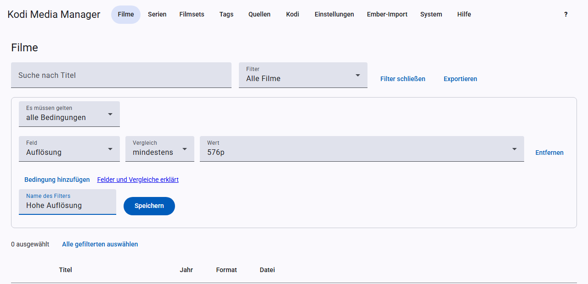

# Filters and batch edit

You can filter the movie and TV show lists, and you can edit everything you have filtered in one go.

## Choosing a filter

The **Filter** field offers “All movies” or “All TV shows”, the built-in filters and your saved filters.

**Built-in for movies:** Unwatched, New (last 30 days), Below 720p, 4K, Without TMDB ID, Without technical details, Without NFO, Without trailer.

**Built-in for TV shows:** With unwatched episodes, Continuing TV shows, New (last 30 days), Episodes below 720p, Without TVDB ID, Episodes without technical details, Without NFO, Without trailer.

## Building your own filter

Click **Edit filter**. A filter consists of conditions, each with a field, a comparison and usually a value. Under **Must match** you choose whether all conditions or just one of them must apply.

| Comparison | Meaning |
|---|---|
| is / is not | exactly this value |
| contains | the text occurs, for example in the title |
| at least / at most | for numbers |
| is missing / is present | the field is empty or filled |

For many fields you pick the value from a list of the values that occur in your library.

**Fields for movies:** Title, Year, Genre, Tag, Country, Studio, Movie set, Watched, User rating, Certification, Edition, Video source, Resolution, Video codec, HDR, Audio codec, Audio language, Subtitle language, Technical details, TMDB ID, IMDb ID, NFO, Trailer, Source, Added days ago.

**Fields for TV shows:** Title, Year, Genre, Tag, Studio/network, Status, Certification, User rating, TVDB ID, TMDB ID, IMDb ID, NFO, Trailer, Source, Added days ago, Number of episodes, Unwatched episodes, and several “Episode: …” fields for resolution, codecs, languages, video source and technical details.

For “Episode: …” it is enough if at least one episode matches. With “is not”, no episode may match.

**Saving:** enter a name at the bottom and click **Save**. The filter then appears in the list. When a saved filter is selected, you can also delete it.

The title search applies in addition to the filter.

## Selecting

- One by one with the checkbox on the left of the list.
- **Select all filtered** takes all matches of the current filter, including those on further pages.
- **Clear selection** empties the selection.

## Batch edit

With **Batch edit selection** (in the TV show list: **Batch edit**) you change all selected entries at once:

- Add or remove **genres and tags**, several separated by commas.
- **Movies:** set or clear certification, edition and video source.
- **TV shows:** set or clear certification and status.

The NFOs are written and Kodi reads the entries again. Nothing is renamed, even if you have turned on automatic renaming.

## More actions for the selection

- **Fetch missing trailers** (TV shows: **Get missing trailers**)
- **Fetch missing theme music** (TV shows: **Get missing theme music**)
- **Refresh ratings** (TV shows: **Update ratings**)
- **Refresh in Kodi**, see [Kodi](kodi.md#updating-manually)
- **Change language** (TV shows: **Change metadata language**), see [Language per entry](scraping.md#language-per-source-and-entry)

There is more on this in [Scraping](scraping.md).
