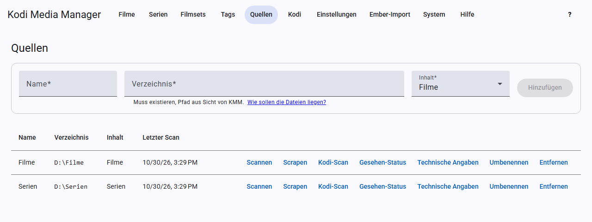

# Getting started

This is how you get from an empty installation to a well-kept library.

**Coming from Ember Media Manager?** Then start with the [Ember import](ember-import.md). It takes over sources, movies, TV shows, settings and Kodi devices. After that, only the API keys from step 1 are missing.

## 1. Enter API keys

For online data you need free keys from the providers. Enter them under [Settings → API keys](settings.md#api-keys). To begin with, TMDB and, if you have TV shows, TVDB are enough.

## 2. Set the language

Under [Settings](settings.md#language), choose the language for metadata, for example `de-DE`, and the preferred artwork language, for example `de`. There are separate fields for movies and TV shows. Save afterwards.

## 3. Add a source

Open **Sources** and add a source for each media directory: name, directory and content (movies or TV shows). There is more on this in [Sources and scanning](sources.md).

## 4. Scan

Click **Scan** for the source. KMM finds the videos and reads existing NFO files. You can see the progress at the top of the page. Afterwards the entries appear under **Movies** or **TV shows**.

## 5. Fetch data

Click **Scrape** for the source. KMM fills in missing metadata and artwork for all entries. A report lists movies or TV shows without a unique match; you then search for them one by one, see [Scraping](scraping.md). If a single new movie is added later, **Scrape** in its view is enough.

## 6. Check and correct

Open individual movies or TV shows and check the details. You apply changes with **Save**. The [filters](filters.md) quickly show you what is still missing, for example “Without TMDB ID”.

## 7. Connect Kodi

Set up your Kodi device under [Kodi](kodi.md) so that it picks up changes automatically.

## 8. Organize your files (optional)

If you want consistent names, define the patterns in the settings and rename the files. Read the [Renaming](renaming.md) chapter first.

## Running tasks

Longer work such as scans runs as a task in the background. It keeps running when you switch pages. Below the header you see the running task and whether more are waiting. On the **Sources** page you can cancel a running scan or scrape.
