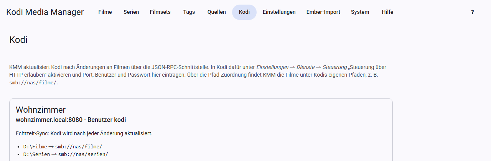

# Kodi

KMM keeps your Kodi devices up to date and fetches the watched status from them.

## Preparing Kodi

In Kodi, open *Settings → Services → Control* and turn on “Allow remote control via HTTP”. Set the port, user name and password there.

## Setting up a device

Open **Kodi** and click **Add Kodi device**.

- **Name:** anything you like, for example “Living room”.
- **Address:** host name or IP address, without `http://`.
- **Port, User, Password:** as set in Kodi. When editing, an empty password field keeps the stored password.
- **Real-time sync:** see below.

Then check the settings with **Test connection**. The result appears on the device’s card. Kodi must be running for this.

## Path mapping

KMM and Kodi often see the same files under different paths. The mapping translates between the two. **Without it, KMM cannot update any entries in Kodi.**

| Path in KMM | Path in Kodi |
|---|---|
| `D:\Filme` | `smb://nas/filme/` |
| `/media/serien` | `nfs://nas/serien/` |

Add one row for each source. You can see the path in Kodi under *Videos → Files*.

**Test connection** also compares the mapping with the sources in Kodi and warns you if Kodi has no source for a path. The same warning appears when KMM starts a scan outside the sources, because in that case Kodi reports no error and reads nothing. Problems during updates stay on screen as a message until you close them with **OK**. The check does not detect differences in upper and lower case.

## Real-time sync

With real-time sync turned on, KMM updates Kodi by itself after every change:

- Changed movie, changed TV show or episode: Kodi reads the entry again. A changed TV show is read again without its episodes.
- If Kodi does not know the entry yet: Kodi scans its folder.
- New entries after a scan: Kodi scans the source.

Several changes in quick succession trigger only one update; KMM waits a few seconds for this. The last sync is shown on the device’s card.

When you remove movies, TV shows, seasons or episodes with the **Remove** buttons (see [Movies](movies.md#remove) and [TV shows](tv-shows.md#remove)), KMM removes them from Kodi as well. Entries that only disappear from KMM through a scan or by removing a source stay in Kodi until the library is cleaned there.

## Updating manually

- **Refresh in Kodi** in the movie, TV show and episode views affects all devices.
- In the TV show view, Kodi reads the TV show and each of its episodes again. The same exists per season, then only for its episodes. KMM sends every episode to Kodi on its own, so Kodi keeps the watched status and resume points. Episodes Kodi does not know yet are picked up by a scan of the TV show folder. KMM shows the progress at the top of the TV show view and the result per device as a message.
- **Refresh in Kodi** in the movie and TV show lists does the same for the selection, for TV shows likewise with all episodes. If a device does not respond, KMM skips it for the rest of the run.
- **Kodi scan** for a [source](sources.md) makes all devices scan the source.

Both also work without real-time sync.

## When Kodi is busy reading

Kodi can only run one scan or clean-up at a time. KMM therefore only starts once Kodi is done:

- **Buttons** wait at most 10 seconds. If Kodi is still busy by then, KMM tells you, and you try again later.
- **Batch edit and real-time sync** wait up to 30 minutes. Further syncs queue up during this time.

## Fetching the watched status

**Watched status** for a source and **Watched status from Kodi** in the views fetch play counts, last played date and your own rating. KMM writes them to the database and the NFO so that Kodi does not lose them when it reads the entry again.

Only higher play counts, more recent dates and ratings are added; nothing is ever reset.

## Several devices

You can add as many devices as you like. If they share the same Kodi database, one device is enough for the watched status.

Kodi is always contacted without the proxy from the settings.
