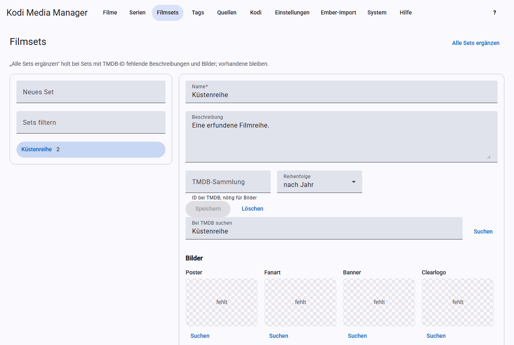

# Movie sets

A movie set groups movies that belong together, for example all parts of a series. Kodi then shows them together. **A movie can only be in one set**; Kodi requires this.

## Creating and editing a set

On the left under **New set**, enter a name and press Enter. The name must be unique. Use **Filter sets** to find existing sets; a click opens the details:

- **Name** and **Description**.
- **TMDB collection:** the ID of the collection at TMDB. It is needed to search for artwork.
- **Order:** sorts the movies in the set by year or by title.

Click **Save**. **Delete** removes the set, not the movies.

## Searching for a collection at TMDB

Under **Search TMDB** you find the matching collection. Clicking a match puts its title, description and ID into the form. Save afterwards.

## Adding and removing movies

- **Add:** search under **Search movies**, tick the checkboxes and click **Add …**. Movies from another set move into this one.
- **Remove:** tick the checkboxes in the set’s movie list and click **Remove …**.

The NFOs of the affected movies are rewritten in the background. With [real-time sync](kodi.md#real-time-sync), Kodi picks up the title, description and artwork.

## Set artwork

Under **Artwork** you choose Poster, Fanart, Banner, Clearlogo, Clearart, Disc, Keyart and Landscape, just as for [movies](scraping.md#artwork). The search needs the TMDB ID of the collection.

Where the artwork is stored is set under [Settings](settings.md#movie-sets). There are two locations that you turn on individually: Ember’s flat scheme and Kodi’s set folders. If neither is turned on, KMM leaves the set artwork in Kodi untouched.

## Completing all sets

**Complete all sets** fetches missing descriptions and artwork for all sets with a TMDB ID. Existing data stays.

## Assigning movies automatically

With the setting “Assign movies to their movie set when scraping”, a movie is put into the set of its TMDB collection when it is scraped. KMM looks for the set by its TMDB ID, then by name, and otherwise creates it. **Another set of the movie is replaced in the process.**
