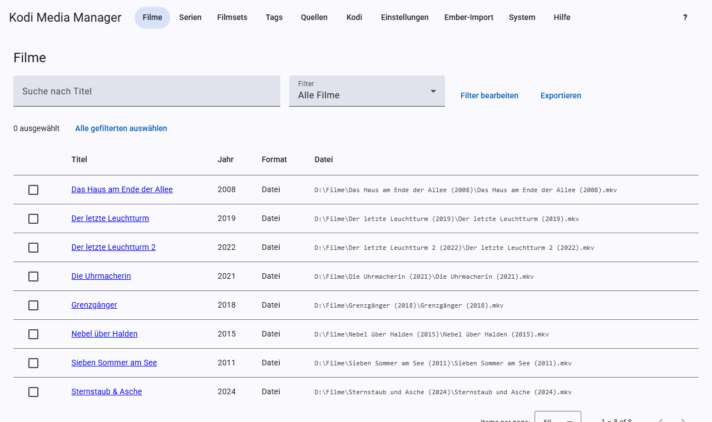
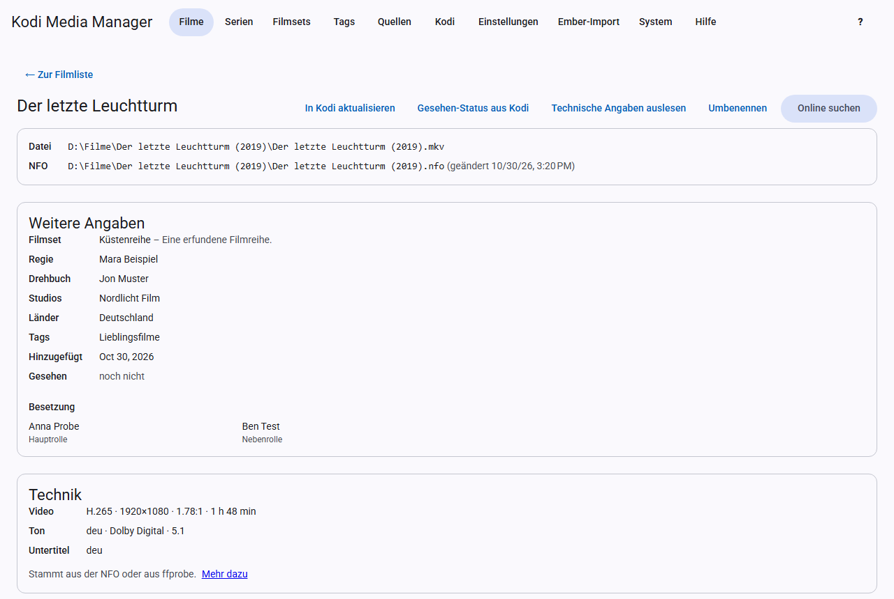

# Movies

## The movie list

The **Movies** page shows all movies with title, year, format, date added and file. Clicking a column header sorts the list by that column; clicking it again reverses the order. With **Added**, for example, you see the newest movies first. The pagination bar sits above and below the list. At the top you can search by title and choose a [filter](filters.md). Use the checkboxes on the left to select movies for [batch actions](filters.md#batch-edit), and use **Export** to download the current list as an [export](export.md).

## The movie view

Clicking a title opens the movie view. From top to bottom it shows:

- **File and NFO:** where the movie and its NFO are stored. If there is no NFO yet, KMM creates it when you save.
- **More details:** movie set, ratings, director, writer, studios, countries, tags, watched status and cast.
- **Technical details:** video, audio and subtitles.
- **Trailer**, **Theme music** and **Artwork**, see [Scraping](scraping.md).
- **Form:** the details you can edit directly.

## Editing details

Change the fields in the form and click **Save**. KMM then writes the NFO and updates Kodi if [real-time sync](kodi.md#real-time-sync) is turned on. **Discard** restores the saved state.

Some fields in detail:

- **Sort title:** sets the order in Kodi, for example “Godfather, The” for “The Godfather”.
- **Edition:** for example “Director’s Cut”. Can be used in the file name and in filters.
- **Video source:** for example `bluray` or `dvd`. Can also be used in the file name, placeholder `{source}`.
- **Certification:** for example “FSK 16”.
- **IMDb ID:** `tt` followed by 7 to 10 digits. Several providers find the movie through it. Without it, Moviepilot, OFDb and OMDb add nothing.
- **TMDB ID:** digits only.
- **Genres:** separate several with commas.

## Buttons in the movie view

| Button | What happens |
|---|---|
| **Refresh in Kodi** | Kodi reads this movie again right away. |
| **Watched status from Kodi** | Fetches play counts and your own rating from Kodi. |
| **Read technical details** | Reads the file with ffprobe. |
| **Rename** | Renames only this movie using the patterns from the settings. |
| **Scrape** | Fills in everything missing, for this movie only, see [Scraping](scraping.md#automatic-scraping). |
| **Search online** | Searches for the movie at a provider, see [Scraping](scraping.md#online-search). |

## Technical details

The **Technical details** card shows codec, resolution, aspect ratio, runtime, HDR, audio tracks and subtitles. The details come from the NFO or from ffprobe. For ffprobe, FFmpeg must be installed, see [Installation](installation.md#additional-programs). You can read them

- individually with **Read technical details**,
- for a whole source under [Sources](sources.md),
- for all episodes of a season in the TV show view, see [Scraping a season](tv-shows.md#scraping-a-season),
- and automatically after scraping and after scanning new files, see [Settings](settings.md#technical-details).

When writing, KMM only replaces this technical part of the NFO; the rest of the file stays unchanged.

## Watched status

KMM fetches the status from Kodi, not the other way round. It only adds higher play counts, more recent dates or a rating, and never resets anything.
