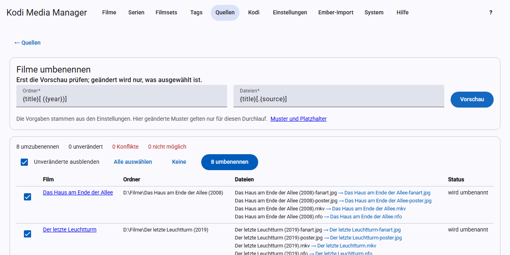

# Renaming

KMM renames folders and files according to patterns. **This changes your media folders.** The first time, check the preview carefully and back up your data beforehand.

## Defining patterns

The patterns are under [Settings → Rename](settings.md#rename). The defaults are:

| What | Default | Result |
|---|---|---|
| Movie folder | `{title}[ ({year})]` | `Heat (1995)` |
| Movie files | `{title}[.{source}]` | `Heat.bluray.mkv` |
| TV show folder | `{show}` | `ALF` |
| Season folder | `Season {season:2}` | `Season 01` |
| Episode files | `{show} - S{season:2}E{episode:2}[ - {title}]` | `ALF - S01E05 - Der Besuch.mkv` |

## How patterns work

- **Placeholders** are written in curly braces: `{title}`.
- **Optional parts** are written in square brackets: `[ ({year})]` is left out together with the brackets if the year is missing.
- **Subfolders** are created with `/`, for example `{title:first}/{title}`. This only works for the movie folder and is relative to the source.

### Formats

A format follows a colon:

| Format | Effect | Example |
|---|---|---|
| `:2` | at least two digits | `{season:2}` → `01` |
| `:first` | first letter | `{title:first}` → `H` |
| `:sort` | sort form of the title | `{title:sort}` |
| `:lower` | lowercase | `{title:lower}` → `heat` |
| `:upper` | uppercase | `{title:upper}` → `HEAT` |

### Placeholders

**Movies:** `{title}`, `{originaltitle}`, `{sorttitle}`, `{year}`, `{edition}`, `{set}`, `{imdb}`, `{tmdb}`, `{genres}`, `{directors}`, `{countries}`, `{mpaa}`, `{rating}`, `{resolution}`, `{videocodec}`, `{audiocodec}`, `{channels}`, `{source}`, `{3d}`

**TV show folder:** `{show}`, `{originaltitle}`, `{sorttitle}`, `{year}`, `{imdb}`, `{tmdb}`, `{tvdb}`, `{genres}`, `{mpaa}`, `{rating}`

**Season folder:** as for the TV show folder, plus `{season}`

**Episode files:** as for the season folder, plus `{episode}`, `{title}` (title of the episode), `{aired}`, `{resolution}`, `{videocodec}`, `{audiocodec}`, `{channels}`, `{source}`, `{3d}`

## Renaming a whole source

1. Click **Rename** for the [source](sources.md).
2. Change the patterns if needed. Changes made here only apply to this run.
3. Click **Preview**. Nothing happens yet.
4. Check the list. With **Hide unchanged** you only see what changes.
5. Select the entries to rename and click **Rename …**.

The preview shows four states:

- **To rename:** can be selected.
- **Unchanged:** already has this name.
- **Conflict:** the target already exists. KMM skips the entry.
- **Not possible:** for example because the file is missing. The reason is shown next to it.

## Renaming a single entry

The movie view and the TV show view have a **Rename** button. It uses the patterns from the settings and asks for confirmation before renaming. Save any unsaved changes first.

## What exactly is renamed

**Movies:** the folder (only if it belongs to this movie alone), the video, further parts of a multi-part movie, and all companion files with the movie’s name, that is NFO, artwork and subtitles. For DVD and Blu-ray only the folder.

**TV shows:** episode files move into season folders together with their NFO, thumbnail and subtitles; then the show folder is renamed. Multi-episode files are named `S01E01E02` and carry all titles. Following Kodi’s rule, season artwork stays in the show folder.

KMM updates the paths in the database and the NFO. If something goes wrong, it reverts the renaming of that entry. Empty old folders are removed.

## Renaming automatically

In the settings you can turn on automatic renaming; it is off at first:

- movies after saving and after scraping,
- TV shows after saving (TV show or episode) and after scraping,
- new episodes during the scan.

Then there is **no preview**. Only turn it on once your patterns have proven themselves.

## What Kodi does

With [real-time sync](kodi.md#real-time-sync), Kodi reads the new folder and cleans up only the old one. Watched status and rating come back from the NFO.
