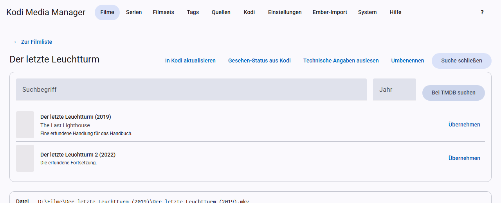
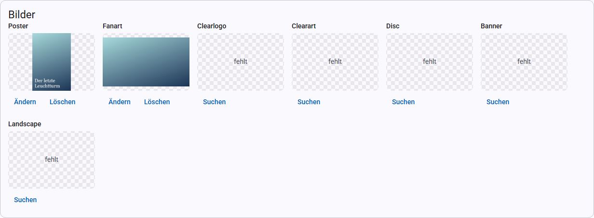

# Scraping: data, artwork, trailers, theme music

“Scraping” means fetching details from the internet. KMM can do this automatically for a single entry, a selection or a whole source. With the online search you match an entry yourself.

## Scraping a new movie

1. Put the file into the folder of the source.
2. On the **Sources** page, click **Scan**. The report lists the new movie; one click opens it.
3. In the movie view, click **Scrape**. KMM fetches metadata, artwork, trailer, theme music and ratings.
4. If the movie then appears under **Without a unique match**, match it via the [online search](scraping.md#online-search) and click **Scrape** once more.

For TV shows you do the same. Several new entries are quickest to handle in the list: choose the filter **New (last 30 days)**, then **Select all filtered**, then **Scrape**.

## Language per source and entry

You set the language of texts and episode names in three places. The first one that specifies something applies:

1. **Movie or TV show:** in the movie or TV show view under **Language**; for several at once, in the list via the selection with **Change language**. Episodes follow their TV show.
2. **Source:** in the **Language** column on the [Sources](sources.md) page.
3. **[Settings](settings.md#language)**.

When you change the language of a movie or TV show, KMM asks whether the texts should be fetched again in this language right away:

- **OK** overwrites the title, plot and genres, for TV shows also season titles and episode names. **Texts you edited by hand are lost as well.** If the provider does not have a text in this language, the old one stays or the text comes in the original language. The outline and the sort title stay unchanged. An entry that has not been matched yet is only applied on a unique match; otherwise it is listed as an error in the message at the end.
- **Cancel** only changes the language. Existing texts stay; the new language applies to empty fields from the next scrape on.

Nothing is renamed, even if the title changes. Changing the language of a source does not change any existing texts.

The language is also stored in the NFO as `<language>`, as in Ember. It also determines which artwork and trailers are suggested first. Moviepilot, OFDb and OMDb always deliver in their own language and fill empty fields regardless of this setting.

## The providers

| Provider | Delivers | Key required |
|---|---|---|
| TMDB | movies, TV shows, artwork, trailers, movie sets | yes |
| TVDB | TV shows, artwork | yes |
| fanart.tv | artwork | yes |
| OMDb | ratings from IMDb, Rotten Tomatoes and Metacritic, English details for empty fields | yes |
| Trakt | community rating | yes (client ID) |
| Moviepilot | German details for empty fields of movies | no |
| OFDb | German details for empty fields of movies | no |
| TelevisionTunes | theme music | no |
| YouTube | theme music, needs yt-dlp | no |

You enter the keys under [Settings](settings.md#api-keys). KMM skips a provider without a key.

## Online search

With the online search you match a single movie or TV show yourself. Here is how:

1. In the movie view, click **Search online**.
2. If needed, choose the **Source** and change the search term and year.
3. Click **Search …**. If nothing turns up, try a different term or leave out the year.
4. Click **Apply** next to the right match. The details are now in the form, but nothing has been saved yet.
5. Check the form and click **Save**.

This only saves the metadata. **Scrape** then fetches artwork, trailer, theme music and ratings.

This is also the way to go for titles that had no unique match during automatic scraping.

## Automatic scraping

**Scrape** is available in these places, and it has the same effect everywhere:

| Where | What is processed |
|---|---|
| Movie or TV show view | this entry |
| Season in the TV show view | only this season, see [Scraping a season](tv-shows.md#scraping-a-season) |
| Movie or TV show list, when you have selected entries | the selection |
| [Source](sources.md) | all entries of the source |

This is what happens:

- It only fills in **missing** metadata and artwork. Existing data stays.
- Entries that have not been matched yet are only applied on a **unique match**. The report lists the others.
- For TV shows it also fills empty episode fields, missing season artwork and thumbnails.
- Missing trailers and reliable theme music matches are added too.
- Enrichment providers fill empty fields and fetch missing ratings. The German providers come before OMDb.
- If [renaming after scraping](settings.md) is turned on, KMM renames the entries as well.

Afterwards a report appears; in the view and in the list it stays until you close it. Entries without a unique match are linked there. If scraping a selection finishes while you are on another page, you find the report in the list under **Result of the last scrape**. KMM keeps it until the server restarts or it drops out of the last 50 tasks.

You can stop a running scrape with **Cancel** in the place where you started it. While it is running in the view, the form is locked so that nothing gets overwritten. Save any unsaved changes first.

Moviepilot and OFDb do not search by title alone: a page is only applied if its IMDb ID matches the movie. This rules out wrong matches, but not every movie finds an entry. Because of a one-second pause between requests, this takes longer for many movies. The first request to OFDb also loads the site’s index and takes correspondingly long.

## Ratings

Automatic scraping only adds missing ratings. To update existing ones, select the entries in the list and click **Refresh ratings**. The free OMDb key allows 1,000 requests per day, so plan for this with large libraries.

## Artwork

The **Artwork** card shows each artwork type with the current image or the note “missing”.

- **Search** or **Change** shows the providers’ suggestions. Click a suggestion to apply it.
- **Delete** removes the image.

Artwork in your preferred language is listed further up, see [Settings](settings.md#language).

**Artwork types for movies:** Poster, Fanart, Clearlogo, Clearart, Disc, Banner, Landscape. The files are named the way Kodi expects, for example `Film-poster.jpg`.

## Trailers

KMM does not download trailers. Instead it adds a link to the NFO, which Kodi plays via the YouTube add-on.

- **Find suggestions** shows trailers from TMDB. Use **Watch** to check them in the browser and **Apply** to add one.
- Under **Custom link** you enter a link by hand; `plugin://`, `http(s)://`, `smb://` and `nfs://` are allowed.
- **Remove** deletes the entry again.

In the list, **Fetch missing trailers** fetches trailers for the selection. Existing links stay.

## Theme music

The theme music is stored as `theme.mp3` in the movie or show folder. **Kodi only plays it with an add-on such as TvTunes.**

- **Find suggestions** shows matches from TelevisionTunes and YouTube. You can listen to them, open their page and save one with **Apply**.
- **Delete** removes the file.

**Fetch missing theme music** in the list and automatic scraping only apply reliable matches with the same title at the provider. YouTube videos never count as reliable; you choose those by hand. An existing `theme.mp3` stays untouched in both cases.
