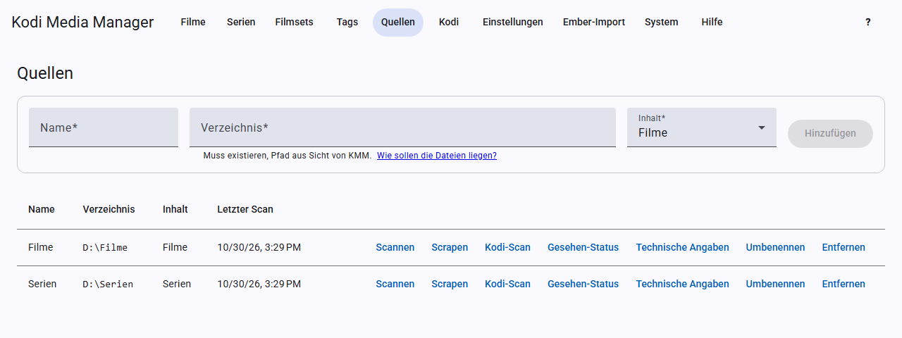

# Sources and scanning

A source is a directory that contains your movies or TV shows. You can add as many as you like.

## Adding a source

Open **Sources** and fill in the fields at the top:

- **Name:** anything you like, for example “Movies”.
- **Directory:** the path as KMM sees it, for example `D:\Filme`. Under Docker it is the path in the container, for example `/media/filme`. The directory must exist.
- **Content:** movies or TV shows.

Then click **Add**.

## How your files should be organised

**Movies:** KMM recognises a movie as a single video file, also in its own folder, as a multi-part movie, and as a DVD or Blu-ray folder. Artwork and NFOs sit next to it following the Kodi scheme, for example `Film-poster.jpg`; for DVD and Blu-ray as `poster.jpg` in the movie folder.

**TV shows:** every folder directly below the source is a TV show. The episodes may be nested at any depth below it. KMM reads the season and episode from the file name, for example `S01E05`. A file with several episodes, such as `S01E01E02`, becomes several episodes sharing the same file.

## Actions per source

| Button | What happens |
|---|---|
| **Scan** | Looks for new and changed files and reads NFOs. For new files it also reads the technical details if that is [turned on](settings.md#technical-details). |
| **Scrape** | Fills in missing metadata and artwork for all entries of the source, old ones included. For individual entries, see [Scraping](scraping.md#automatic-scraping). |
| **Kodi scan** | Makes all Kodi devices scan this source, see [Kodi](kodi.md). |
| **Watched status** | Fetches play counts and your own ratings from Kodi. |
| **Technical details** | Reads the details with ffprobe: **Read missing** or **Read all again**. |
| **Rename** | Opens the preview for [renaming](renaming.md). |
| **Remove** | Removes the source and all its entries from KMM, after asking you. Your files stay where they are. You remove single movies, TV shows, seasons or episodes in their views, see [Movies](movies.md#remove) and [TV shows](tv-shows.md#remove). |

While a task is running, the row shows the progress and a **Cancel** button.

## Language of a source

In the **Language** column you choose the language in which the entries of this source are scraped if they do not have a language of their own. Existing texts do not change. There is more on this in [Scraping](scraping.md#language-per-source-and-entry).

## Where title, year and IMDb ID come from

An NFO next to the movie always takes precedence. Without an NFO, the following applies to movies:

- **Title:** the unchanged name of the folder, for example `Wonka (2023) tt6166392`. Scraping replaces it with the provider’s title. For searching at the provider and for renaming, KMM leaves out the year and the IMDb ID.
- **Year and IMDb ID:** from the file name. If they are not there, KMM takes them from the folder name.

The folder only counts if it contains exactly one movie; otherwise the file name applies. This also applies to files directly in the source folder. **So do not put a single movie directly into a collection folder such as `Action`**, or it would be called `Action`.

For TV shows, all three come from the name of the show folder.

If the year or IMDb ID is missing for an entry that is already known, the next scan adds it, as long as the entry has not been matched yet. A title that still comes from the file name is replaced with the one from the folder. After scraping, or after matching via the online search, the name no longer changes anything. The scan does not write any files while doing this.

If the name contains an IMDb ID, scraping looks for exactly that entry instead of searching by title. If the ID is wrong, the entry ends up in the report under **Without a unique match**, or the wrong movie is applied.

## The report after a scan

The result of the last scan is shown in the **Last scan** column, even if you left the page in the meantime. If the scan found something, a report opens at the bottom, which you can open again at any time with **Details**. It lists

- new movies, TV shows and episodes, each with a link to the entry,
- updated and removed entries,
- NFOs that KMM could not read,
- for TV shows, the **Files without a recognisable episode**. KMM does not add them because the name contains no season and episode such as `S01E05`. Rename them and scan again.

For TV shows, **new**, **updated** and **removed** count the episodes. KMM cuts long lists off after 200 entries. The result and the report are lost when KMM restarts, until you scan again.

## The report after scraping

If something is left open after scraping, a report appears at the bottom:

- **Without a unique match:** you have to search for these titles one by one.
- **Errors:** something went wrong, for example when writing a file.
- **Notes:** for example, a provider that has not been set up.

## File extensions and excluded folders

Which files count as videos and which folders the scan skips is set under [Settings](settings.md#scan).
