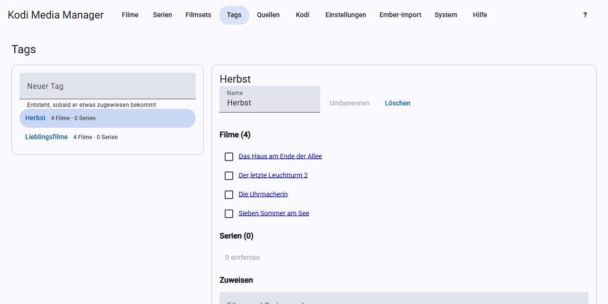

# Tags

Tags are keywords of your choice for movies and TV shows, for example “Christmas” or “Kids”. Kodi can filter by them.

On the left, the **Tags** page shows all tags with the number of movies and TV shows. A click opens a tag.

## New tag

Under **New tag**, enter a name and press Enter. The tag only really exists once something is assigned to it.

## Assigning

Search under **Search movies and TV shows**, tick the checkboxes and click **Assign …**.

## Removing

Tick the checkboxes in the tag’s list and click **Remove …**. The movie or TV show itself is of course kept.

## Renaming and deleting

Change the **Name** and click **Rename**. If the new name already exists, the two tags are merged. **Delete** removes the tag from all entries.

## What happens in the background

Every change writes the NFOs of the affected entries as a background task. With [real-time sync](kodi.md#real-time-sync), Kodi then reads them again.

The quickest way to set tags for many entries at once is [batch edit](filters.md#batch-edit).
