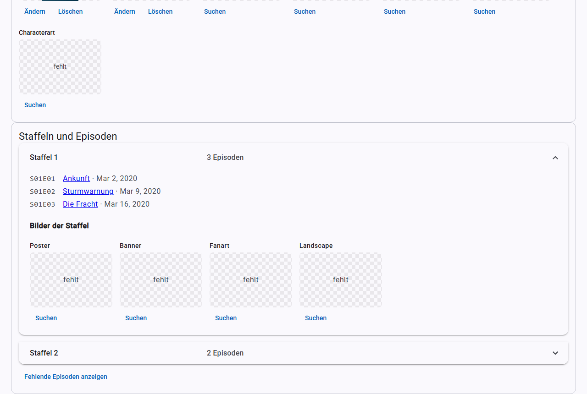

# TV shows and episodes

## The TV show list

The **TV shows** page works like the [movie list](movies.md#the-movie-list): with search, [filters](filters.md), selection, [export](export.md), sorting via the column headers, and a pagination bar above and below the list.

## The TV show view

Clicking a title opens the TV show:

- **Folder and NFO:** where the TV show and its `tvshow.nfo` are stored.
- **Trailer**, **Theme music** and **TV show artwork**, see [Scraping](scraping.md).
- **Seasons and episodes:** expandable, with the artwork of each season.
- **More details:** cast and ratings.
- **Form:** the details of the TV show.

You save the form with **Save**, just as for movies. In addition there are **Status** (`Continuing` for still running, `Ended` for finished), **Networks/studios** and **Tags**, each separated by commas.

### Missing episodes

**Show missing episodes** asks the provider which episodes exist that you have no file for. This is only a display; KMM does not create anything for them.

## Scraping a TV show

**Scrape** in the TV show view fills in everything missing for this TV show only, including empty episode fields, see [Scraping](scraping.md#automatic-scraping).

## Scraping a season

When you expand a season under **Seasons and episodes**, you find two buttons:

- **Scrape season** works like **Scrape**, but only for this season. It fills empty fields of its episodes and fetches missing season artwork and thumbnails of its episodes.
- **Refetch season** replaces the titles and plots of the episodes with those from the provider, including ones you edited by hand. That is why KMM asks you first. Whatever the provider does not have stays. Existing artwork is not replaced.

Both buttons also fill in the season title; **Refetch season** replaces it. The other details of the TV show stay unchanged. Trailers, theme music and ratings belong to the whole TV show and only come via **Scrape**. If a TV show has not been matched yet, **Scrape season**, like **Scrape**, only applies it on a unique match. **Refetch season** needs a matched TV show.

If reading technical details during scraping is turned on, KMM reads, after changes, those episodes of the season that do not have technical details yet. If [renaming after scraping](settings.md) is turned on, it renames the season folder and episode files of this season; the show folder stays.

Progress and report appear at the top of the TV show view. While a season or the TV show is being scraped, all scrape buttons of the TV show are locked.

**Read technical details** reads all episodes of the season again with ffprobe, including those that already have details. The track languages from the NFO are kept, as with the [technical details](movies.md#technical-details) of movies. KMM shows the progress above the seasons and the result as a message. While this is running, the scrape buttons of the TV show are locked, because both write to the same NFOs.

**Refresh in Kodi** on a season makes Kodi read all episodes of that season again; the button at the top of the TV show view does this for the TV show and all episodes (see [Kodi](kodi.md#updating-manually)).

## Online search for TV shows

**Search online** works as it does for [movies](scraping.md#online-search). The default is TVDB. The applied details first go into the form. When you save, KMM also completes the episodes, filling only their empty fields. A note above the buttons tells you beforehand how many episodes are affected.

Which episode order applies (aired, DVD or absolute) is set under [Settings](settings.md#tv-shows). This only affects TVDB; TMDB only knows the aired order.

## The episode view

Clicking an episode opens its view with file, NFO, thumbnail, technical details and a form. It also has **Refresh in Kodi**, **Watched status from Kodi** and **Read technical details**.

If several episodes share a file, KMM writes the NFO for all episodes of that file.

## Removing

You remove episodes, seasons and whole TV shows with the buttons **Remove** in the episode view, **Remove season** in an expanded season and **Remove TV show** at the top of the TV show view. KMM first shows which entries are affected and asks how to remove them:

- **From the library only** (default): the entries disappear from KMM and, with [real-time sync](kodi.md#real-time-sync) turned on, from Kodi. The files stay where they are, and KMM remembers nothing. The next scan of the source adds them again.
- **Delete the files as well:** KMM also deletes the files for good, without a recycle bin. The confirmation lists every file, and the button then reads **Delete for good**.

What is deleted:

| What | Files |
|---|---|
| Episode | the video file with everything that carries its name followed by a dot, hyphen, underscore or space: NFO, thumbnail (`-thumb.jpg`), subtitles |
| Season | all episode files of the season as above, plus the season artwork in the show folder (`season01-poster.jpg` etc.) |
| TV show | the whole show folder with everything in it. The confirmation names files that KMM does not know. |

**Multi-episode files:** if a file contains several episodes (e.g. `S01E02E03`), KMM always removes the whole file with all its episodes, even if you chose only one of them. The confirmation names all affected episodes. If such a file reaches into another season, those episodes go as well, and a note says so.

Folders that are empty afterwards are removed too: for episodes and seasons up to the show folder, for a TV show up to the source. KMM never deletes the source itself or anything outside it. If a TV show is the source itself, only **From the library only** is possible. A file that cannot be deleted is listed in the final message; the other files and the entries are gone nevertheless.

## Artwork for TV shows

| For | Artwork types | Files |
|---|---|---|
| TV show | Poster, Fanart, Banner, Clearlogo, Clearart, Landscape, Characterart | `poster.jpg` etc. in the show folder |
| Season | Poster, Banner, Fanart, Landscape | `season01-poster.jpg`, `season-specials-poster.jpg` in the show folder |
| Episode | Thumb | `<episode>-thumb.jpg` next to the episode |
