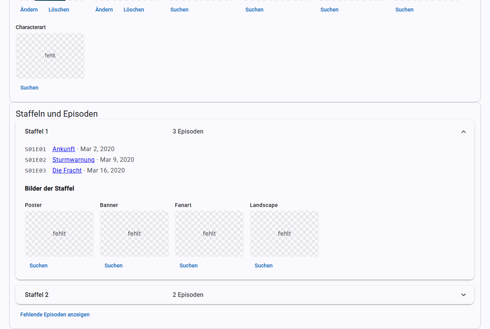

# TV shows and episodes

## The TV show list

The **TV shows** page works like the [movie list](movies.md#the-movie-list): with search, [filters](filters.md), selection, [export](export.md), sorting via the column headers, and a pagination bar above and below the list. Like the movie list, it keeps its page, filter and position when you come back from a TV show or episode.

## The TV show view

Clicking a title opens the TV show:

- **Folder and NFO:** where the TV show and its `tvshow.nfo` are stored.
- **Trailer**, **Theme music** and **TV show artwork**, see [Scraping](scraping.md).
- **Seasons and episodes:** expandable, with the artwork of each season.
- **More details:** cast and ratings.
- **Form:** the details of the TV show.

You save the form with **Save**, just as for movies. In addition there are **Status** (`Continuing` for still running, `Ended` for finished), **Networks/studios** and **Tags**, each separated by commas.

### Missing episodes

**Show missing episodes** asks the provider which episodes exist that you have no file for. This is only a display; KMM does not create anything for them.

### Episode order

Some TV shows count their seasons and episodes differently depending on the provider. A made-up show “The Big Heist” has two seasons of 15 episodes each when aired on TV, but four parts with shorter episodes on a streaming service. KMM matches the provider's data by the season and episode number in the file name, so the order must match your files.

Under **Episode order** in the TV show view you choose the order for this TV show. When you open the list, KMM asks the providers which orders they know for the show:

- **TVDB** offers e.g. “Aired Order”, “DVD Order”, “Absolute Order” or the order of a streaming service such as “Netflix Order”.
- **TMDB** offers the aired order and so-called episode groups, e.g. “Netflix Order (Digital)”.

Only providers at which the TV show is already identified are offered. If it is not yet, scrape it first. **Default (settings)** goes back to the order from the [Settings](settings.md#tv-shows).

After you choose, KMM asks whether to fetch the titles and plots of all episodes in the new order right away. **OK** overwrites the existing texts, including manually edited ones. **Cancel** only changes the order, which then applies from the next scrape on. KMM does not rename the files.

With an own order KMM always scrapes the TV show at the provider of that order, even if another one is preferred in the settings. The order is kept in KMM's database only, not in the NFO, because Kodi has no field for it.

### Scraper of the TV show

Normally KMM gets a TV show's data from the first provider in the order of its [source](sources.md#source-scrapers). If no numbering of that provider matches your files for a single TV show, choose another one under **Scraper** in the TV show view. An example: the made-up TV show “In the Misty Forest” has two orders at TVDB, but your files follow TMDB's. Then choose TMDB.

After you choose, KMM asks whether to identify the TV show at the new provider right away and to fetch the titles and plots of the TV show and all its episodes again. **OK** overwrites the existing texts, including manually edited ones. **Cancel** only changes the scraper; it applies from the next scrape on. If the provider does not find the TV show unambiguously, KMM reports it; then the [online search](tv-shows.md#online-search-for-tv-shows) helps.

An episode order of another provider no longer applies, as its numbers belong to that provider. The other way round, choosing an episode order of another provider also changes the scraper. **Default of the source** resets the choice. Like the order, the scraper is kept in KMM's database only.

## Scanning a TV show or season

If you have added episodes to the folder of a TV show or deleted some, you do not need to scan the whole source. **Scan** at the top of the TV show view reads only the folder of this TV show again: new episodes are added, episodes without a file are removed from the library, and changed NFOs are taken over. **Scan** on a season does the same for the episodes of that season only. In the TV show list you can scan several selected TV shows at once.

After that, things go on as after [scanning a source](sources.md): the technical details of new episodes are read, the TV show is renamed if that is enabled, and Kodi devices with [real-time sync](kodi.md#real-time-sync) look through the folder of the TV show or season.

If the folder cannot be reached or no longer contains any video files, KMM reports this and removes nothing. You remove a TV show that no longer exists with [Removing](tv-shows.md#removing).

## Scraping a TV show

**Scrape** in the TV show view fills in everything missing for this TV show only, including empty episode fields, see [Scraping](scraping.md#automatic-scraping).

## Scraping a season

When you expand a season under **Seasons and episodes**, you find two buttons:

- **Scrape season** works like **Scrape**, but only for this season. It fills empty fields of its episodes and fetches missing season artwork and thumbnails of its episodes.
- **Refetch season** replaces the titles and plots of the episodes with those from the provider, including ones you edited by hand. That is why KMM asks you first. Whatever the provider does not have stays. Existing artwork is not replaced.

Both buttons also fill in the season title; **Refetch season** replaces it. The other details of the TV show stay unchanged. Trailers, theme music and ratings belong to the whole TV show and only come via **Scrape**. If a TV show has not been matched yet, **Scrape season**, like **Scrape**, only applies it on a unique match. **Refetch season** needs a matched TV show.

If reading technical details during scraping is turned on, KMM reads, after changes, those episodes of the season that do not have technical details yet. If [renaming after scraping](settings.md) is turned on, it renames the season folder and episode files of this season; the show folder stays.

Progress and report appear at the top of the TV show view. While a season or the TV show is being scraped, all scrape buttons of the TV show are locked.

**Read technical details** reads all episodes of the season again with ffprobe, including those that already have details. The track languages from the NFO are kept, as with the [technical details](movies.md#technical-details) of movies. KMM shows the progress above the seasons and the result as a message. While this is running, the scrape buttons of the TV show are locked, because both write to the same NFOs.

**Refresh in Kodi** on a season makes Kodi read all episodes of that season again; the button at the top of the TV show view does this for the TV show and all episodes. **Scan in Kodi** makes Kodi look for new episodes in the folder of the season or TV show and then remove entries whose files are gone (see [Kodi](kodi.md#updating-manually)).

## Online search for TV shows

**Search online** works as it does for [movies](scraping.md#online-search). The TV show's scraper is preselected. If you take over a match from another provider than the source's default, the TV show keeps that provider as its [scraper](tv-shows.md#own-scraper). The applied details first go into the form. When you save, KMM also completes the episodes, filling only their empty fields. A note above the buttons tells you beforehand how many episodes are affected.

Which episode order applies (aired, DVD or absolute) is set under [Settings](settings.md#tv-shows). This only affects TVDB. Other orders, such as a streaming service's, are chosen per TV show under [Episode order](tv-shows.md#episode-order).

## The episode view

Clicking an episode opens its view with file, NFO, thumbnail, technical details and a form. It also has **Refresh in Kodi**, **Watched status from Kodi** and **Read technical details**.

**Scrape** and **Refetch** work like **Scrape season** and **Refetch season** (see [Scraping a season](tv-shows.md#scrape-season)), but only for this episode: **Scrape** fills empty fields and fetches a missing thumbnail, **Refetch** replaces the title and plot with those of the provider after asking. The TV show and its seasons stay unchanged. If renaming on scrape is turned on, KMM then checks the file names of the whole season.

If several episodes share a file, KMM writes the NFO for all episodes of that file.

## Removing

You remove episodes, seasons and whole TV shows with the buttons **Remove** in the episode view, **Remove season** in an expanded season and **Remove TV show** at the top of the TV show view. KMM first shows which entries are affected and asks how to remove them:

- **From the library only** (default): the entries disappear from KMM and, with [real-time sync](kodi.md#real-time-sync) turned on, from Kodi. The files stay where they are, and KMM remembers nothing. The next scan of the source adds them again.
- **Delete the files as well:** KMM also deletes the files for good, without a recycle bin. The confirmation lists every file, and the button then reads **Delete for good**.

What is deleted:

| What | Files |
|---|---|
| Episode | the video file with everything that carries its name followed by a dot, hyphen, underscore or space: NFO, thumbnail (`-thumb.jpg`), subtitles |
| Season | all episode files of the season as above, plus the season artwork in the show folder (`season01-poster.jpg` etc.) |
| TV show | the whole show folder with everything in it. The confirmation names files that KMM does not know. |

**Multi-episode files:** if a file contains several episodes (e.g. `S01E02E03`), KMM always removes the whole file with all its episodes, even if you chose only one of them. The confirmation names all affected episodes. If such a file reaches into another season, those episodes go as well, and a note says so.

Folders that are empty afterwards are removed too: for episodes and seasons up to the show folder, for a TV show up to the source. KMM never deletes the source itself or anything outside it. If a TV show is the source itself, only **From the library only** is possible. A file that cannot be deleted is listed in the final message; the other files and the entries are gone nevertheless.

## Artwork for TV shows

| For | Artwork types | Files |
|---|---|---|
| TV show | Poster, Fanart, Banner, Clearlogo, Clearart, Landscape, Characterart | `poster.jpg` etc. in the show folder |
| Season | Poster, Banner, Fanart, Landscape | `season01-poster.jpg`, `season-specials-poster.jpg` in the show folder |
| Episode | Thumb | `<episode>-thumb.jpg` next to the episode |
